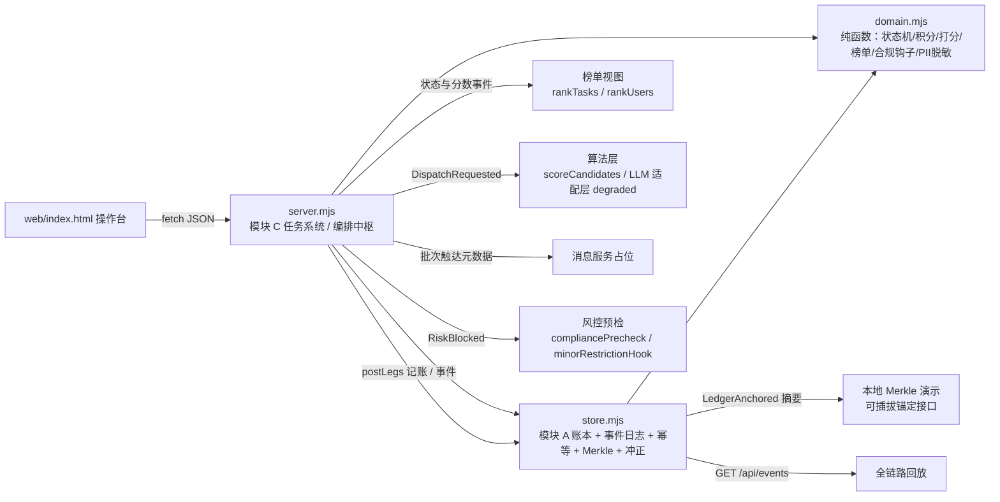

# 02 · 技术架构与接口契约（三宝殿项目初版）

> 角色：研发负责人 ｜ 版本：**v0.3（阶段 C 主代理最终裁决收敛后）** ｜ 基线：`三宝殿项目方案_v1.0.md` + `CONTRACT.md`（主代理 v0.2 裁决口径）
> 本文对应可运行原型 `src/domain.mjs`、`src/store.mjs`、`src/server.mjs`、`web/index.html`、`tests/smoke.mjs`。
> 阶段 B 依据 `README.md`、`docs/01-产品需求与路线图.md`、`COMPLIANCE.md`、`docs/03-合规基线与SBC白皮书要点.md`、`docs/07-上线检查清单.md` 交叉评审，补齐 8 项缺口并把自检扩充至 **20 项**；逐条矩阵见 `review/engineering-review.md`（阶段 B 记录，其中 `net_sbc` 计入口径与 `SettlementRequested` 两项个人表态**已被阶段 C 主代理裁决覆盖，以本文为准**）。
> **阶段 C 按主代理最终裁决收敛（6 项整改全部落地）**：① 回退 `net_sbc` 为「仅赏金本金」，高质量奖励仍进 `available` 但不计入用户榜分；② 路径 A **不采用** `SettlementRequested`，运行期事件名全量收敛至 CONTRACT §4 登记集合；③ D8「关闭个性化」如实登记为**进程级全局单例**；④ `store.mjs:sanitizePayload()` 改为**键白名单 + 自由文本统一剥离**；⑤ 接口数 / 自检数 / `DispatchExposed`·`DispatchIgnored` 表述统一；⑥ `node --check` 与连跑自检验证，20 项断言全绿。
> **全部演示数据均为虚构样例**；SBC 为平台内贡献积分凭证，非加密资产、非支付工具，不可转让、不可兑付法币、无收益承诺。

---

## 1. 目标与边界

初版目标只有一句话：**用零第三方依赖的最小闭环，证明方案里的状态机、积分、算法、榜单、事件与合规口径是可落地、可复算、可回放的**。它不是生产系统。

| 做 | 不做 |
|---|---|
| **15 个 `/api/*` 端点 + 静态 `GET /` = 16 个接口**（CONTRACT §8 全量） | 真实支付 / 持牌托管 / 法币计价 |
| 发布→审核→推送→接单→提交→验收→结算闭环 | 真实大模型 / 向量召回 / 在线反馈校准 |
| 不可变事件日志 + 不可变积分流水 + 五科目守恒 + 反向冲正 | 真实许可链 / 目标市场合规界定（D-12） / 上链锚定 |
| 六维推送打分、六维任务榜、四维用户榜（含权重版本） | 转让 / 交易 / 法币兑换 / 二级市场 / 收益承诺 |
| 本地 Merkle 摘要演示（零 PII、零任务正文） | 真实 PII 采集、明文联系方式、精确定位轨迹 |
| 服务端强制生效的「关闭个性化推荐」 | 生产鉴权、限流、审计导出、运营审批留痕 |
| 未成年人限制 / 举报入口的**代码钩子占位**（V8 未上线） | 真实实名核验、举报 24h 处置闭环 |

技术约束：Node.js 22 ESM（`.mjs`），仅 `node:` 内置模块（`http` / `crypto` / `fs` / `path` / `url` / `child_process` / `net`），无 `package.json`、无 `npm install`；内存存储；`PORT` 环境变量可覆盖（默认 8787）。

---

## 2. 模块划分与联动图

| 文件 | 层次 | 职责 | 依赖 |
|---|---|---|---|
| `src/domain.mjs` | 领域纯函数层 | 状态机、积分规则、打分/榜单口径、LLM 适配层、违禁预检、成果 PII 脱敏、合规钩子占位 | 无（零副作用） |
| `src/store.mjs` | 仓储层 | 内存状态、幂等集合、不可变事件/流水、五科目、反向冲正、Merkle、dry_run | `node:crypto` + `domain` |
| `src/server.mjs` | 编排层（模块 C） | 路由、事务边界、状态迁移编排、调用 A / 算法 / 榜单 / 事件 | `node:http` 等 + 上述两层 |
| `web/index.html` | 操作台 | 单页演示 UI，无 CDN；展示合规钩子状态 | 浏览器 `fetch` |
| `tests/smoke.mjs` | 自检 | spawn 服务、**20 项断言**（含仓储 / 域函数单元级验证）、退出码 | `node:child_process/net/crypto` + `store` |



**单一事实源**：任务状态只在 `server.mjs` 的状态机里迁移；账本科目只在 `store.mjs` 的 `postLegs()` / `postReversal()` 里变更；榜单与算法只读、不反向写业务状态。口径冲突时以状态机与账本为准，按事件回放重算。

---

## 3. HTTP 接口表（CONTRACT §8 全量）

**接口数**：15 个 `/api/*` 端点 + 静态 `GET /`（`/index.html` 同源静态页）= **16 个接口**。`server.mjs:ROUTES` 登记 15 个 `/api/*`，静态页在 `handle()` 内单独处理，未登记路径一律 404。

**统一响应结构**：成功 `{ ok:true, data:<对象>, error:null }`；失败 `{ ok:false, data:null, error:{ code, message } }`。
**统一幂等**：所有写接口接受可选 `event_id`（字符串）。提供时，重复投递返回首次结果并带 `idempotent:true`，不产生第二次状态迁移、事件或流水；未提供时正常处理（每个接口内部仍为记账生成唯一 `event_id`，保证只追加一次）。失败结果**不**进入幂等缓存，允许修正后重试。
**统一错误码**：`ILLEGAL_TRANSITION`（400）、`TASK_ALREADY_ACCEPTED`（409）、`COMPLIANCE_BLOCKED` / `MINOR_RESTRICTION_BLOCKED` / `SOLVER_FILTERED`（422）、`REJECT_LIMIT`、`INSUFFICIENT_BALANCE`、`NOT_ASSIGNED_SOLVER`、`INVALID_FIELD` / `MISSING_FIELD`、`NOT_FOUND`（404）、`INTERNAL_ERROR`（500）。

| # | 方法 | 路径 | 主要请求字段 | 主要 `data` 字段 |
|---|---|---|---|---|
| 1 | GET | `/api/health` | — | `status, service, version, port, time` |
| 2 | POST | `/api/tasks` | `publisher_id, title, description, category, bounty, acceptance_criteria, deadline_hours, online, radius_km, required_skills, difficulty, minor_blocked(布尔占位), event_id` | `task{...compliance.hooks}, compliance{...hooks}, rule_version` |
| 3 | POST | `/api/tasks/:id/review` | `decision: approve\|reject, event_id` | `task, decision, freeze{bounty, service_fee, total}` |
| 4 | POST | `/api/tasks/:id/dispatch` | `top_k, batch_size, expand, expand_to, supply_ratio, channel, dry_run, event_id` | `dispatch_id, mode, weight_version, algorithm_degraded, personalized, llm_hint, candidates[], filtered_out[], batches[], strategy` |
| 5 | GET | `/api/tasks` | `?include_terminal=true`（可选，默认过滤终态） | `count, tasks[], include_terminal, note` |
| 6 | GET | `/api/leaderboard/tasks` | — | `rank_weight_version, weights, mode, items[]{rank, rank_score, top_factors[]}` |
| 7 | GET | `/api/leaderboard/users` | — | `rank_weight_version, weights, note, items[]{rank, net_sbc, rank_score}` |
| 8 | POST | `/api/tasks/:id/accept` | `solver_id, event_id` | `task, escrow_total, note` |
| 9 | POST | `/api/tasks/:id/submit` | `solver_id, content(提交前做 PII 脱敏), event_id` | `task{result_preview(脱敏), result_pii_redacted}, note` |
| 10 | POST | `/api/tasks/:id/verify` | `decision: approve\|reject\|auto_accept, reason, rating, event_id` | `task, settlement{...}`；内部广播 `CreditTransferred → SettlementCompleted`（事件名收敛至 CONTRACT §4） |
| 11 | POST | `/api/tasks/:id/dispute` | `action: open\|resolve, resolution: pay_solver\|refund_publisher\|close, event_id` | `task, escrow_total, transferred:false, arbitration, llm_summary{degraded, decision:null}` |
| 12 | GET | `/api/ledger/:userId` | — | `user_id, available, credit_score, entries[], subjects{}, balance_check{}, merkle{root}` |
| 13 | GET | `/api/events` | `?task_id=`（可选） | `count, task_id, replayable:true, events[]` |
| 14 | GET | `/api/config` | — | 权重版本、三套权重、算法降级状态、`personalized_enabled`、`compliance`（含钩子标记）、`chain`、`ledger`、`demo_users` |
| 15 | POST | `/api/preferences/personalized` | `enabled: boolean, event_id` | `personalized_enabled, enforcement:'server_side', neutral_sort_rule` |
| 16 | GET | `/` 、`/index.html` | — | `text/html` 静态操作台 |

**关键字段口径**

- `candidates[]` 每条含 `solver_id / name / rank / score / factors / contributions / weights / weight_version / level_boost_applied / reason_codes[] / batch / channel`；`filtered_out[]` 含硬过滤原因码。关闭个性化时 `score:null`、`reason_codes` 仅 `NEUTRAL_*`。
- `entries[]`（积分流水）每条含 `seq, ts, event_id, batch_id, task_id, rule_version, account, subject, delta, before, after, direction, memo, prev_hash, hash`；冲正流水 `memo` 以 `reversal:` 开头，delta 为原流水逐条取反。
- `events[]` 每条含 `seq, ts, type, task_id, event_id, version, actor, payload`；`payload` 经 `store.mjs:sanitizePayload()` **键白名单 + 自由文本统一剥离**：仅登记过的结构化 / 枚举 / 数值 / 标识 / 容器键可写入，未登记键（`description/title/content/criteria/phone/id_card` 等任务正文与 PII 字段）一律丢弃，`reason/note/hits/summary` 等自由文本值统一替换为 `[已剥离]`，白名单内字符串再做 PII 正则兜底抹除（阶段 C 整改 4，自检 ⑯ 覆盖驳回理由夹带验证）。`LedgerAnchored.payload` 另含 `on_chain_fields` 白名单与 `privacy_scan`。
- `balance_check` 含 `balanced, total, expected, by_subject{...}, ledger_entries`。
- `compliance.hooks`：`{ minor_restriction: minorRestrictionHook(), report_entry: reportEntryHook() }`，均为**占位钩子**，`pii_collected:false`、`endpoint:null`。
- **成果正文**：`hSubmit` 先经 `domain.mjs:sanitizeSubmissionText()` 做手机号/身份证号正则脱敏，只把脱敏后的 `text` 落入内存；`taskView` 只暴露 `result_preview`（脱敏）与 `result_pii_redacted`，原始正文从不落库、不进事件日志（自检 ⑲）。

---

## 4. 状态机与超时

状态机常量在 `domain.mjs:STATE_MACHINE`，迁移一律经 `canTransition(from,to)` 校验，**非法迁移返回 `ILLEGAL_TRANSITION` 且不产生副作用**。阶段 C 路径 A：结算不再发送 `SettlementRequested`，状态在 `settleTask()` 内由 `SUBMITTED/DISPUTED → SETTLED` 迁移，记账与事件编排合并为纯规则流程（运行期事件名全量收敛至 CONTRACT §4）。

| 状态 | 合法后继 | 超时规则（初版实现程度） |
|---|---|---|
| `DRAFT` | `PENDING_REVIEW` / 丢弃 | 7 天清理（未实现时钟） |
| `PENDING_REVIEW` | `PUBLISHED` / `REJECTED` | 审核 ≤ 30 min（未实现时钟） |
| `PUBLISHED` | `DISPATCHING` / `CANCELLED` | 24h 未推送告警（未实现） |
| `DISPATCHING` | `ACCEPTED` / `EXPIRED` / `CANCELLED` | 扩量上限转人工（参数化元数据） |
| `ACCEPTED` | `IN_PROGRESS` / `CANCELLED` / `EXPIRED` | 独占 3 min / 技能类 15 min（未实现计时器） |
| `IN_PROGRESS` | `SUBMITTED` / `EXPIRED` / `DISPUTED` | deadline（记录但不自动触发） |
| `SUBMITTED` | `SETTLED` / `DISPUTED` / `IN_PROGRESS`（驳回 ≤2 次） | 24h 自动验收（`decision:'auto_accept'` 手动触发） |
| `DISPUTED` | `SETTLED` / `CANCELLED` / `CLOSED` | 72h 结案（记录，未实现时钟） |
| `SETTLED` | `CLOSED` | 结算回写同步完成 |
| `REJECTED/CANCELLED/EXPIRED/CLOSED` | 终态 | 归档 |

**接口到迁移的映射**：发布→`PENDING_REVIEW`；审核通过→`PUBLISHED`（冻结）；推送→`DISPATCHING`；接单→`ACCEPTED` 并在同一次编排内经 `IN_PROGRESS` 到提交后的 `SUBMITTED`；验收通过/自动验收→`SETTLED`（结算）；驳回→`IN_PROGRESS`（可再次提交，上限 `MAX_REJECT=2`）；争议→`DISPUTED`；裁定→`SETTLED`/`CANCELLED`/`CLOSED`。

**争议隔离**：`hVerify` 强制要求 `state === 'SUBMITTED'`，因此 `DISPUTED` 状态下无法借验收接口触发 `DISPUTED → SETTLED` 这一合法迁移来转付赏金；转付只能由 `dispute(action:'resolve')` 在人工裁定后执行。这是「裁定前不转付」在状态机层面的硬保证（自检 ⑧ 覆盖）。

---

## 5. 算法分层、LLM 边界与降级

### 5.1 推送打分 `Score(t,u)`

```
Score = 0.30·P_accept + 0.35·P_complete_on_time − 0.10·C_notify
      − 0.10·R_risk + 0.08·V_fairness + 0.07·B_supply
```

`DISPATCH_WEIGHTS` 常量和恒为 1.00，`weight_version = "v1.0"`。分层严格按 `domain.mjs:scoreCandidates`：

1. **L1 硬过滤**（`hardFilter`，先于打分、一票拦截）：`RISK_BLACKLIST` / `QUALIFICATION_MISMATCH` / `OUT_OF_RADIUS` / `LOAD_FULL` / `DAILY_PUSH_CAP` / `RELATED_PARTY`。
2. **类目内归一化**：六项原始因子做 P5–P95 截断 + min-max（`normalizeInCategory`）。
3. **加权求和**：产出 `raw_score` 与逐项 `contributions`，可复算。
4. **等级加权封顶**：`score = raw_score × (1 + min(level_boost_rate, 0.05))`，`LEVEL_BOOST_CAP = 0.05`，`reason_codes` 标注 `LEVEL_BOOST_CAPPED_5PCT`（演示用户「接单人乙」配置 0.08，被封顶到 0.05）。
5. **重排与分批**：Top-K 截断、按 `batch_size` 分批、`expand_to` 扩量节奏元数据（`buildBatches`）；初版为**参数级 + 元数据级**，无真实消息通道与时钟触发（见 §10.1、裁决 5）。

### 5.2 榜单

- 任务榜 `TASK_RANK_WEIGHTS`：悬赏价值 0.25 / 紧迫度 0.20 / 完成可行性 0.20 / 发布方信用 0.15 / 热度 0.10 / 质量 0.10；同类目内归一化；输出 Top3 影响因子；**争议中任务降权 50%**；自然排序不接受付费置顶。
- 用户榜 `USER_RANK_WEIGHTS`：净获得 SBC 0.55 / 有效完成单量 0.20 / 加权评价 0.15（贝叶斯平滑 `m=10, prior=4.2`）/ 准时率 0.10（样本 <5 取类目先验）。
- **阶段 C 最终口径（主代理裁决，回退阶段 B 个人表态）**：`net_sbc` **只累加「已验收通过任务的赏金本金」**。评价 ≥4.5 的 +2% 高质量奖励由生态激励池支出、仍进接单人 `available` 余额，但按方案 §4.1.5「赠送、补偿、邀请、活动奖励、争议中积分一律不计入，防止刷榜」应排除，**不计入 `net_sbc` 与用户榜分**；冻结、托管、未结算 / 争议中任务一律不计入（自检 ⑮ 验证：结算者 = 200 赏金本金、奖励 4 SBC 不混入，争议中接单人 = 0；自检 ② 验证奖励仍进余额）。
- `rank_weight_version = "v1.0"`。

### 5.3 LLM 边界与降级

`domain.mjs` 只暴露三个可替换接口，初版**一律返回规则化兜底结果并标记 `degraded:true`**：

| 接口 | 用途 | 输出约束 |
|---|---|---|
| `extractTaskStructure(task)` | 结构化抽取 + 质量/完整度评分 | 仅作特征，供榜单与合规预检 |
| `semanticMatchHint(task,user)` | 语义匹配分与推荐理由 | 仅作附加特征，不决定名单 |
| `summarizeDispute(dispute)` | 争议材料摘要与事实抽取 | `decision: null`，**模型不直判** |

`GET /api/config` 固定返回 `algorithm.degraded:true` / `llm_mode:'rule_fallback'` / `dispatch_continues_on_degrade:true`；`hDispatch` 在降级下照常产出 Top-K 并落 `DispatchSent`，**推送不中断**（自检 ⑨）。结算、争议裁定、账号处罚均由规则 + 人工兜底：`settleTask()` 为纯规则记账、无任何模型决策字段（阶段 C 删除 `SettlementRequested`）；`dispute(resolve)` 显式标注 `arbitrator:'人工裁定演示'`；自检 ⑫ 验证结算事件名 ⊆ 契约 §4、无契约外事件名、无 `model_decision` 非 null 值、争议态裁定前不转付。

### 5.4 个性化开关（服务端强制）

`POST /api/preferences/personalized` 是 `store.preferences.personalized_enabled` 的**唯一写入点**。`hDispatch` 与 `hLeaderboardTasks` 只读取该服务端值，**忽略请求体里客户端传入的 `personalized` / `enabled`**；关闭时改走 `neutralCandidates`（按 `registered_at` 时间 + `distance_km` 距离排序）与 `neutralTaskOrder`，候选 `score:null`、`reason_codes` 仅 `NEUTRAL_TIME` / `NEUTRAL_DISTANCE`。开关状态在 `/api/config.personalized_enabled` 可见（自检 ⑦）。**D8 如实登记**：初版该开关为**进程级全局单例**（`store.preferences` 单份内存状态，一人关闭影响全进程），**未实现账号级按 `user_id` 隔离**，不得宣称已实现账号级（见 §10.1 第 12 条、§11 待确认项第 6 条，账号级列 P1）。

---

## 6. 事件与幂等

### 6.1 事件清单（CONTRACT §4 登记集合，阶段 C 收敛）

**运行期实际产生**（全部落在契约 §4 登记集合内）：`TaskPublished` / `TaskUpdated` / `CreditFrozen` / `CreditTransferred` / `CreditChanged` / `DispatchRequested` / `DispatchScored` / `DispatchSent` / `TaskAccepted` / `TaskSubmitted` / `TaskVerified` / `DisputeOpened` / `DisputeResolved` / `SettlementCompleted` / `RankUpdated` / `TaskDelisted` / `LedgerAnchored` / `RiskBlocked` / `PreferenceChanged`。其中 `RiskBlocked` / `PreferenceChanged` 由主代理 v0.2 补登记。

> **阶段 C 裁决（路径 A，覆盖阶段 B 差异登记）**：`SettlementRequested` 虽在方案 §4.3.3 环节 5、§5.1 第 10 步、§4.4 点名，但产品 `review/product-review.md` 裁决 2 明确不采用，主代理亦未在 CONTRACT §4 登记该事件。按契约 §0 差异由主代理在 v0.2 §11 统一登记，研发侧**删除 `settleTask()` 中该事件的发送**，运行期事件名全部收敛至契约 §4。结算仍由 C 编排、A 记账，`CreditTransferred → SettlementCompleted` 顺序不变，模型全程不直判（自检 ⑫ 验证「结算事件集合 ⊆ 契约 §4、无契约外事件名、争议态不转付、无模型决策字段」）。
>
> **接单环节 `RankUpdated`**：PRD §4.1 第 7 步要求 `TaskAccepted / RankUpdated / TaskDelisted` 三个事件，首轮仅发首尾两个，阶段 B 已补 `RankUpdated`（自检 ⑱）。
>
> **客户端埋点（P1，初版未产生）**：`DispatchExposed` / `DispatchIgnored` 在 CONTRACT §4 登记为「客户端」产生方，初版无客户端埋点与曝光 / 忽略回传链路，**不产生这两个事件**，列为 P1（见 §10.1 第 13 条）。

事件日志为只追加的冻结对象数组；`GET /api/events?task_id=` 可按任务回放全链路（自检 ⑩ 覆盖 9 类必需事件，⑫ 覆盖事件名收敛与人工兜底，⑱ 覆盖接单事件完整性）。事件 `payload` 经 `store.mjs:sanitizePayload()` **键白名单 + 自由文本统一剥离**：未登记键（任务正文 / PII 字段）丢弃，`reason/note/hits/summary` 等自由文本不落原值，白名单内字符串再做 PII 正则兜底抹除（自检 ⑯ 全量扫描 + 驳回理由夹带验证、⑲ 成果 PII 扫描、⑳ 扫描器确定性回归验证）。

### 6.2 幂等三层

1. **接口层** `withIdempotency(event_id, fn)`：命中缓存直接返回首次结果（带 `idempotent:true`），不执行 handler。
2. **记账层** `store.ledgerEventIds`：`postLegs()` 对同一 `event_id` 只追加一次流水；`postReversal()` 使用独立 `reversalEventId`，重复调用返回已有冲正流水。
3. **状态层**：状态迁移本身经 `canTransition` 校验，重复迁移被拒。

自检 ③ 用同一 `event_id` 连投两次审核，验证冻结流水与 `CreditFrozen` 事件各只有一条。

---

## 7. 数据与积分双流

### 7.1 数据流

```
发布表单 → 违禁预检 + 未成年人限制准入钩子 → 结构化特征(degraded) → 任务状态机
   → 事件日志(脱敏/不可变) → 榜单重算 / 推送留痕 / 回放 / 训练标签占位
提交成果 → sanitizeSubmissionText() PII 脱敏 → 只存脱敏文本 → 事件仅记录 pii_redacted 布尔
```

榜单与算法只读任务快照，不反向写状态；`dry_run` 通过 `store.beginDryRun()/endDryRun()` 让 `appendEvent` / `postLegs` / `recordDispatch` 变为不落库预览，任务状态不变（自检 ⑪）。`GET /api/tasks` 默认过滤终态（PRD US-02），带 `?include_terminal=true` 可查全量供审计（自检 ⑱）。

### 7.2 积分流与五科目守恒

科目：`available`（用户可用）/ `frozen`（冻结）/ `escrow`（托管）/ `platform_revenue`（平台收入）/ `eco_incentive`（生态激励）。

| 动作 | legs（delta，合计恒为 0） | 规则 |
|---|---|---|
| 审核通过 | `user:pub −total`；`frozen +total` | `total = bounty + 5% 服务费` |
| 接单 | `frozen −total`；`escrow +total` | 全额转托管，裁定前不转付 |
| 结算 | `escrow −total`；`user:solver +bounty`；`platform_revenue +fee`；`eco_incentive −bonus`；`user:solver +bonus` | 评价 ≥4.5 额外 +2%，单任务上限 50 SBC |
| 争议发起 | 不移动（已全额托管）；`escrowed` 标记 | 不产生任何 `settle:` 流水 |
| 争议裁定退回 | `escrow −total`；`user:pub +total` | 人工裁定后才分账 |
| **违规冲正（阶段 B 补齐）** | 原流水各 leg 的 `delta` 逐条取反 | `store.postReversal()` 只追加、原流水不可变 |

`postLegs()` 强制校验 `Σdelta === 0`，否则抛错拒绝记账；每条流水为 `Object.freeze` 的不可变记录、只追加。**冲正以反向流水实现**已落地：`store.postReversal(originalEventId, reversalEventId)` 读取原流水、逐条取反、复用 `postLegs()` 的守恒校验与哈希链，原流水保持不变（自检 ⑭ 在仓储单元级验证「原流水仍在 / 反向 delta / 账本回到初始 / 守恒」）。`GET /api/ledger/:userId` 返回 `balance_check`，断言 `Σ用户可用 + 四科目 === totalSupply`（自检 ② 覆盖）。

`domain.mjs` 另实现 `computeCancelSettlement()`（已接单取消：90% 解冻 + 10% 补偿接单人）、`timeoutCreditPenalty()`（超时信用分 −5，释放冻结）、`computeQualityBonus()`（评价奖励）。因 CONTRACT §8 未定义「取消」「超时触发」「违规处罚」接口，前两者及冲正的 HTTP 编排**未暴露**（冲正能力在仓储层已具备，待 P1 接运营后台）；争议 `resolve(refund_publisher)` 复用了全额退回路径。

---

## 8. 账本 Merkle 演示说明

- `store.computeMerkleRoot()`：以每条流水的 `hash` 为叶子，两两 `sha256(left+right)` 逐层归约（奇数补位）得到 Merkle 根；空账本返回 `sha256('empty-ledger')`。
- 流水 `hash = sha256(seq|event_id|task_id|rule_version|account|delta|before|after|memo|prev_hash)`，形成哈希链（`prev_hash` 指向上一条）；**哈希输入仅数值与元数据，零 PII、零任务正文**。
- `store.anchorLedger(trigger)`：生成 `anchor_id / merkle_root / ledger_count / ledger_version / prev_anchor_hash / anchor_hash`，并广播 `LedgerAnchored` 事件；结算时自动触发一次。`LedgerAnchored.payload` 现含 `on_chain_fields` 白名单与 `privacy_scan`，供外部自动化核验（自检 ⑯）。
- **上链白名单** `on_chain_fields = [merkle_root, ledger_count, ledger_version, prev_anchor_hash, ts]`：仅哈希与元数据，不含 `title/description/content/criteria/phone/name` 等字段。`privacy_scan` 对锚定载荷做 PII（手机号 / 身份证号正则）与任务正文关键词扫描，演示结果恒为 `pii_hits:0 / task_text_hits:0`、`pii_on_chain:false / task_text_on_chain:false`。自检 ⑯ 另对全量事件载荷（排除哈希字段后）做 PII 正则与任务正文扫描，命中数均为 0。**阶段 B 补充修复**：`scanAnchorText()` 先剥离 32–64 位十六进制摘要片段再扫描 —— 摘要是哈希值而非文本字段，其数字子串会被手机号 / 证件号正则偶发误判为 PII，导致 `privacy_scan.pii_hits` 非确定性非 0；自检 ⑳ 对此做确定性双向回归验证（hex 不误判 + 真实 PII 仍可检出 + 多次锚定恒为 0）。
- 定位为**可插拔锚定接口**：`anchorLedger()` 是唯一出口，P2 可替换为许可链 / 合规 BaaS 的批次上链实现，替换不改链下账本权威口径。链下为实时权威，链上仅作不可篡改校验（方案 §4.1.2）。**初版不接公链、不做真实锚定**。

---

## 9. 运行与自检

```bash
# 启动（默认 8787，可用 PORT 覆盖）
PORT=8787 node src/server.mjs
# 浏览器打开 http://127.0.0.1:8787/

# 自检（自行 spawn 随机空闲端口、轮询 /api/health、结束关闭子进程）
node tests/smoke.mjs
# 期望：PASS 20 / FAIL 0 / 全绿，退出码 0

# 静态页简单确认
curl -s -o /dev/null -w "%{http_code}\n" http://127.0.0.1:8787/
curl -s http://127.0.0.1:8787/api/config
```

自检断言清单（阶段 A 11 项 + 阶段 B/C 9 项 = 20 项，原断言一条未删；期望 `PASS 20 / FAIL 0`）：

| 编号 | 断言 |
|---|---|
| ① | 端到端闭环 发布→审核→推送→接单→提交→验收→结算 |
| ② | 结算流水正确 + 五科目平衡 |
| ③ | 重复 `event_id` 不重复记账（幂等） |
| ④ | 非法状态迁移被拒 |
| ⑤ | 4 人并发接单仅一人成功 |
| ⑥ | SBC 转让 / 交易 / 兑换 / 收益类接口全部 404 |
| ⑦ | 关闭个性化后中性排序且开关在 `/api/config` 可见（服务端强制） |
| ⑧ | 争议全额托管、裁定前不转付（含借验收接口转付被拒） |
| ⑨ | 算法降级标记存在且推送不中断 |
| ⑩ | 事件流按 `task_id` 回放完整链路 |
| ⑪ | `dry_run` 不落库、不改状态 |
| **⑫** | **结算编排事件名收敛 + 人工兜底：结算 / 全量运行期事件 ⊆ 契约 §4、无 `SettlementRequested`、仍发 `CreditTransferred`/`SettlementCompleted`、争议态不转付、无模型决策** |
| **⑬** | **未成年人限制 / 举报入口钩子可见、占位拦截生效、前端不采集明文 PII** |
| **⑭** | **反向流水冲正：原流水不可变、只追加、delta 取反、账本回到初始且守恒** |
| **⑮** | **用户榜 `net_sbc` 仅赏金本金：高质量奖励不混入；争议中 / 未结算任务为 0** |
| **⑯** | **事件日志零 PII / 零任务正文（驳回理由夹带验证）与 Merkle 锚定载荷（可验证扫描）** |
| **⑰** | **Top-K 截断与分批扩量参数生效（批次 / 通道 / 扩量元数据）** |
| **⑱** | **驳回任务从列表/榜单下架；接单广播 `TaskAccepted`/`RankUpdated`/`TaskDelisted`** |
| **⑲** | **提交成果 PII 脱敏：明文手机号 / 证件号不落内存、不进事件日志** |
| **⑳** | **上链摘要扫描确定性回归：hex 摘要不误判为 PII、真实 PII 仍可检出、多次锚定 `privacy_scan` 恒为 0** |

---

## 10. 初版已知限制与演进路径

### 10.1 已知限制（如实登记，不夸大实现范围，均不破坏本轮闭环）

1. **内存存储**：进程重启全部重置；无持久化、无数据库事务、无并发隔离（依赖 Node 单线程同步代码块实现接单原子锁）。
2. **无真实时钟**：超时自动验收、独占窗口、分批扩量、72h 争议结案、DRAFT 清理均为参数/元数据或手动触发，未实现定时器与告警。
3. **LLM 全降级**：三接口均为规则兜底；无向量召回、无离线回放校准（ECE/AUC）、无 A/B 与权重灰度发布。
4. **榜单为全量实时重算**：无增量更新、缓存分片、快照降级、反作弊回溯重算、公示记录。
5. **无真实外围系统**：消息通道、虚拟号真实分配、实名/资质、支付托管、风控模型、运营审批留痕、审计导出、鉴权与越权控制、限流熔断。**未成年人限制与举报入口本轮仅补齐「代码钩子 + 布尔占位 + 配置可见 + 前端入口占位」**（`minorRestrictionHook` / `reportEntryHook`），真实实名核验与举报 24h 处置闭环仍为上线一票否决项 V8，未实现、不伪装已交付。
6. **链为本地演示**：仅 Merkle 摘要与可插拔接口，无许可链、无真实锚定（境外版按 D-12 无需境内备案）、无 T+1 对账与用户自查页。
7. **部分积分规则未接入 HTTP**：取消已接单分账、超时信用分 −5、双向评价、邀请的编排未暴露（纯函数或口径预留）；**冲正能力已在仓储层落地**（`postReversal`），但 §8 无处罚 / 冲正端点，HTTP 未暴露。
8. **竞赛制（S3 多中标）未实现**：初版仅非竞赛制先到先得。
9. **分批扩量仅参数级**：`top_k / batch_size / expand / expand_to / supply_ratio / channel` 已生效并落库为元数据（自检 ⑰），但无真实分批触达、无时钟驱动的扩量、无「运营暂停/重试/扩量审批留痕」（方案 §4.3.3 环节 2 要求），列为 P1。
10. **提交成果仅文本**：图片 / 视频 / 定位打卡 / 硬件凭证未实现；成果正文已做 PII 脱敏（自检 ⑲），但无附件存储与内容安全检测（图像预检等），列为 P1。
11. **发布方资质预检未实现**：PRD US-01「资质不符」拦截目前仅覆盖接单人侧 `hardFilter` 与发布方 role/存在性校验；发布方实名资质为 P1。
12. **D8 个性化开关为进程级全局单例**：`store.preferences.personalized_enabled` 是全进程单份内存状态，`POST /api/preferences/personalized` 一人关闭会影响**全进程所有用户**的推送与任务榜；「服务端强制生效」已实现（自检 ⑦），但**账号级按 `user_id` 隔离未实现**，初版不得宣称已实现账号级。账号级开关（用户维度持久化 + 按用户读取）列为 P1。
13. **客户端埋点事件初版未产生**：`DispatchExposed` / `DispatchIgnored` 在 CONTRACT §4 登记为「客户端」产生方，初版无客户端 SDK 与曝光 / 忽略回传链路，服务端**不产生**这两个事件（§6.1 已登记），明确列为 **P1 客户端埋点**，不得计入初版已交付能力。
14. **事件日志脱敏为键白名单**：`sanitizePayload()` 仅放行登记键，`reason/note/hits/summary` 等自由文本值统一替换为 `[已剥离]`、不落原值，因此事件流中的说明文字不可回放原文；如需可审计的理由文本，P1 须引入脱敏后的结构化理由码，不得回退到明文（阶段 C 整改 4）。

### 10.2 演进路径

| 阶段 | 重点 | 对应方案里程碑 |
|---|---|---|
| **P1** | 持久化与真实事务；定时器驱动超时/独占/扩量；取消与冲正的运营后台编排；双向评价与邀请（含频次上限）；争议仲裁中心与人工后台；未成年人实名核验与举报处置闭环（V8）；发布方资质与图像/附件内容安全；**账号级个性化开关（D8，按 `user_id` 隔离）**；**客户端埋点 `DispatchExposed`/`DispatchIgnored` 与曝光/忽略回传**；LLM 接入但保留降级与留痕；链下/链上锚定与 T+1 对账；榜单增量 + 快照降级 + 反作弊；实名资质、虚拟号、鉴权限流；灰度与权重版本发布流程 | M2–M5、P1 MVP 灰度、G6/V8 |
| **P2** | 推送 v2 多目标模型 + 在线反馈校准；实时多维榜单与个性化（账号级开关）；竞赛制多中标；企业发布方对账/发票；开放 API；**目标市场合规复核（V2-O 持续项，D-12）** + 白皮书正式发布 + 第三方安全测试；两项中国境内备案仅在复评触发时按 `docs/10` 恢复 | P2 完整版 |
| **P3** | 智能硬件终端（大屏播报、身份核验打卡、离线队列补传），依赖 P2 接口冻结 | P3 硬件试点 |

---

## 11. 合规约束在代码中的落点（对照 CONTRACT §10 逐条 + docs/03 §4）

| # | 红线 / 硬性约束 | 代码落点（文件 + 函数） | 自检断言 | 是否满足 |
|---|---|---|---|---|
| **§10.1** | 禁止 SBC 转让/交易/法币兑换/收益承诺/二级市场接口或文案；积分变动仅限五科目；冲正以反向流水实现 | `server.mjs:ROUTES` 白名单 + 404 分支；`store.mjs:postLegs()` 五科目守恒；`store.mjs:postReversal()` 反向流水；`store.mjs:config().compliance.sbc_transfer_or_redeem_api=false` | ⑥、②、**⑭** | **满足**（阶段 B 补齐冲正） |
| **§10.2** | 不存明文手机号/身份证/精确定位轨迹；联系方式虚拟号；日志/事件/流水脱敏；上链 PII 命中 = 0 | `domain.mjs:sanitizeContact()/makeVirtualNumber()/compliancePrecheck()/minorRestrictionHook()/sanitizeSubmissionText()`；`server.mjs:createTaskImpl()/hSubmit()/taskView()`；**`store.mjs:sanitizePayload()` 键白名单 + 自由文本统一剥离（阶段 C 整改 4）**；`web/index.html` 无 PII 输入控件 | ②、③、⑧、**⑬**、**⑯**、**⑲**、**⑳** | **满足**（阶段 B 补齐成果正文脱敏，阶段 C 补齐事件日志键白名单与驳回理由夹带验证；原型零 PII 采集，强于加密存储要求） |
| **§10.3** | 禁止模型直判结算/争议裁定/账号处罚；`DisputeOpened`/`DisputeResolved` 保留人工兜底；`summarizeDispute()` 仅材料摘要；运行期事件名 ⊆ 契约 §4 | `server.mjs:settleTask()` 纯规则记账（阶段 C 删除 `SettlementRequested`，无模型决策字段）；`server.mjs:hVerify()` 限定 `SUBMITTED`；`server.mjs:hDispute(resolve)` 标注 `arbitrator:'人工裁定演示'`；`domain.mjs:summarizeDispute()` 固定 `decision:null` | ⑧、⑨、**⑫** | **满足**（阶段 C 事件名收敛 + 人工兜底可验证） |
| **§10.4** | 关闭状态不得被客户端覆盖；关闭后时间+距离中性排序；`GET /api/config` 暴露开关；每条命中输出 `reason_codes` | `server.mjs:hPreferences()` 唯一写入点；`server.mjs:hDispatch()/hLeaderboardTasks()` 只读服务端值、忽略客户端传参；`domain.mjs:neutralCandidates()`；`store.mjs:config().personalized_enabled` | ⑦ | **满足** |
| **§10.5** | 禁止裁剪未成年人限制、违禁预检、举报入口相关钩子；**V2-O 境外发布合规基线六组按契约 §11 D-12 为上线闸门**（原两项境内备案归档为触发式预案） | `domain.mjs:compliancePrecheck()` 违禁预检；`domain.mjs:minorRestrictionHook()/reportEntryHook()` 钩子占位；`server.mjs:createTaskImpl()` 发布前置准入拦截；`store.mjs:config().compliance` 的 `minor_restriction_hook/report_entry_hook`；`web/index.html` 前端入口占位 | **⑬**（+ 操作台违禁词演示） | **满足（钩子层）**；真实实名核验 / 举报处置 / V2-O 六组核销为上线闸门（D-12），§10.1 明示未实现；境外基线见 `docs/11`，境内备案申报口径已归档见 `docs/10` |
| **§10.6** | Merkle / 锚定载荷零 PII、零任务正文；初版不接公链 | `store.mjs:computeMerkleRoot()/anchorLedger()/scanAnchorText()`；`on_chain_fields` 白名单；`LedgerAnchored.payload.on_chain_fields + privacy_scan` | **⑯、⑳** | **满足**（阶段 B 补齐可验证扫描；⑳ 修复 hex 摘要偶发假阳性并做确定性回归） |
| **§10.7** | 演示数据全部虚构，不得写入真实个人信息 | `store.mjs:demoUsers()` 全为虚构名；`domain.mjs:makeVirtualNumber()`；`web/index.html` 顶部声明；自检中的 `13800001234` / 证件号均为虚构脱敏测试串 | ⑥、⑬、⑯、⑲、⑳ | **满足** |
| **docs/03 §4 补充** | 模型降级、幂等与可审计、服务端中性排序、Merkle 不上链 PII、权重版本留痕 | `domain.mjs` 三适配接口 `degraded:true`；`server.mjs:withIdempotency()`；事件 `version` + 流水 `rule_version`；`GET /api/config` 的 `weight_version / rank_weight_version` | ③、⑦、⑨、⑩、⑯、⑳ | **满足** |

### 主代理最终裁决落地状态（阶段 C；阶段 B 待拍板项已全部定稿）

1. **冻结时点（裁决：维持「审核通过后冻结」）**：方案 §4.1.4「触发时点＝审核通过」、§5.2、CONTRACT §5、PRD §0.5 一致；PRD US-01 / §4.1 第 2 步「发布即冻结」及方案旅程描述与之冲突，以基准值为准。`POST /api/tasks` 只做合规预检 + 余额预校验，审核通过进入 `PUBLISHED` 才冻结（避免 `REJECTED` 终态产生孤立冻结记录，G4）。**阶段 C 已完成：PRD v0.3 与 CONTRACT v0.2 §8 均已同步**，差异登记见 §11 D-01 / D-08。
2. **`net_sbc` 口径（裁决：仅赏金本金，阶段 C 已回退）**：产品 `review/product-review.md` 裁决 3 明确「仅赏金本金」；方案 §4.1.5「赠送、补偿、邀请、活动奖励、争议中积分一律不计入，防止刷榜」，高质量奖励由生态激励池支出应排除。阶段 C 已把 `settleTask()` 改回 `net_sbc += bounty`（自检 ⑮），**阶段 B「赏金本金 + 高质量奖励」表态作废**；奖励仍进 `available` 余额（自检 ②）。
3. **争议退款时服务费（维持全额托管、退款时一并退回）**：原型把「赏金 + 5% 服务费」全额转托管，裁定退款时全额退回发布方（未成交不收服务费）。方案 §5.2 平台收入进入条件为「结算」；若改判「服务费不退」需在裁定前确认平台收入，与「裁定前不转付」冲突。请财务 / 法务书面确认后由主代理定稿。
4. **`SettlementRequested`（裁决：路径 A 不采用，阶段 C 已删除）**：法务 `review/legal-review.md` M3 推荐路径 A、产品裁决 2 明确不采用，主代理未在 CONTRACT §4 登记该事件。阶段 C 已删除 `settleTask()` 中该事件，运行期事件名**全部收敛至契约 §4 登记集合**（自检 ⑫）。方案 §4.3.3 / §5.1 / §4.4 的差异由主代理在 CONTRACT v0.2 §11 统一登记，研发不再主张补发。
5. **dry_run 与分批扩量（裁决：维持参数级）**：`dry_run` 已做到「完全不落库、不改状态、任意状态可预览」（自检 ⑪）；分批参数已生效并落库为可回放元数据（自检 ⑰）。真实分批触达、时钟驱动扩量、运营审批留痕依赖消息通道与定时器，属 P1，本轮不实现（§10.1 第 9 条）。
6. **D8 个性化开关（阶段 C 如实登记）**：初版为**进程级全局单例**，一人关闭影响全进程；账号级按 `user_id` 隔离列 P1，初版不得宣称已实现账号级（§10.1 第 12 条）。服务端强制中性排序本身已满足 CONTRACT §10.4（自检 ⑦）。
7. **CONTRACT 版本同步（仍需主代理处理）**：本地 `CONTRACT.md` 副本仍标记 **v0.1**，§4 表格未含 `RiskBlocked` / `PreferenceChanged`、无 §11 差异段落；主代理裁决口径为 **v0.2**（含 §11 统一登记）。本文件与原型按主代理裁决口径实现，但**契约文件本体须由主代理更新版本号并通知三方**，研发按边界约束不改该文件。自检 ⑫ 的允许集合已按 v0.2 口径（§4 八类 + 补登记两事件）定义。

---

*本文（v0.3）与 `src/`、`web/`、`tests/` 同版本；`review/engineering-review.md` 为阶段 B 记录，其中被阶段 C 主代理裁决覆盖的两项口径（`net_sbc` / `SettlementRequested`）以本文为准。任何权重数值、积分规则、状态机迁移与合规口径变更，须经产品 + 研发 + 法务评审并更新版本号后生效。*
