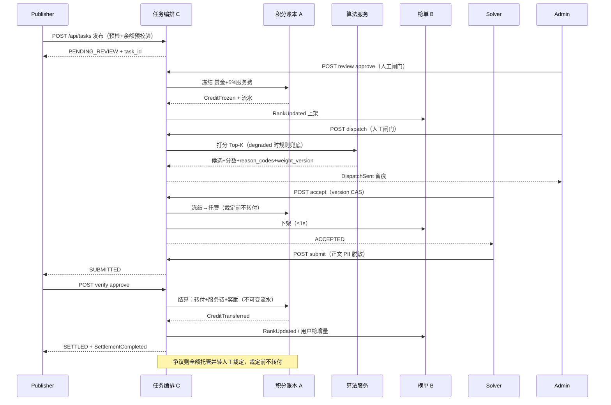
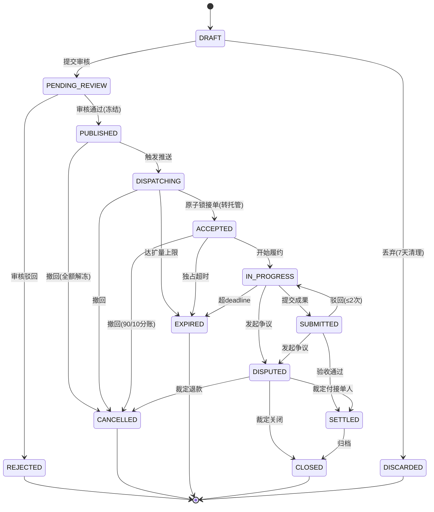

# 三宝殿 · 悬赏互助平台 系统架构设计

| 项 | 内容 |
|---|---|
| 文档名称 | 系统架构设计（System Architecture Design） |
| 版本 | v1.0（正式评审稿） |
| 日期 | 2026-11-19 |
| 项目 | 三宝殿 · 悬赏互助平台（Web 单端用户产品站） |
| 部署形态 | Cloudflare Pages（Pages Functions + D1），`git push origin main` Git 集成自动部署 |
| 口径基线 | `CONTRACT.md` v0.2、`三宝殿项目方案_v1.0.md`、`docs/12-生产系统架构与部署.md`、`docs/13-完全体能力与运营就绪.md` |
| 配套文档 | `docs/project/01-需求规格说明书.md`、`docs/project/03-功能规格说明.md` |
| 代码真源 | `functions/api/[[path]].js`（入口）、`prod/lib/api.js`（编排）、`prod/lib/domain.js`（领域口径，逐字节同步自 `src/domain.mjs`） |

> **阅读约定**：架构口径以生产系统（`docs/12`/`docs/13`）为准，与 L0 原型（`docs/02`）并存但互不套用结论。状态机、积分公式、推送权重、榜单权重、合规预检、PII 脱敏、LLM 兜底全部复用 `src/domain.mjs` 生成副本，**不存在第二套口径**（CONTRACT §11 D-13/D-14）。

---

## 目录

- [1. 架构总览与原则](#1-架构总览与原则)
- [2. 逻辑架构图](#2-逻辑架构图)
- [3. 技术栈](#3-技术栈)
- [4. 部署架构](#4-部署架构)
- [5. 关键设计决策与权衡](#5-关键设计决策与权衡)
- [6. 数据流与事件流](#6-数据流与事件流)
- [7. 状态机图](#7-状态机图)
- [8. 安全架构](#8-安全架构)
- [9. 可用性与降级](#9-可用性与降级)
- [10. 架构决策记录（ADR）](#10-架构决策记录adr)
- [11. 可观测与容量](#11-可观测与容量)

---

## 1. 架构总览与原则

### 1.1 三条架构原则（方案 §0）

| 原则 | 含义 | 架构落点 |
|---|---|---|
| 单一事实源 | 任务状态只由任务编排层迁移，积分账本只由记账层变更，榜单与算法只读 | `prod/lib/api.js` 编排 + `postLegs()`/`postReversal()` 记账 + `rankTasks`/`scoreCandidates` 只读 |
| 人工兜底 | 结算、争议裁定、账号处罚、审核、自动验收由规则或人工确认，模型只给建议 | admin-only 端点 + `audit_log` + `model_decision:null` |
| 全链路可审计 | 任一 `task_id` 可完整回放发布→推送→接单→验收→流水→榜单变更 | `events` 表 + `ledger_entries` 哈希链 + `GET /api/events?task_id=` |

### 1.2 三层分离：C 编排 / A 记账 / B 展示

| 层 | 职责 | 唯一事实源 | 不做什么 |
|---|---|---|---|
| **C 任务编排** | 任务全生命周期编排、事务边界、状态迁移、幂等、超时、结算调度 | 任务状态机 | 不实现账本、不算榜单分、不做模型推理 |
| **A 用户与积分** | 身份、SBC 账本、五科目记账、哈希链、锚定、账号级偏好 | 不可变流水 + 用户主数据 | 不判任务状态、不算排序、不决定推送 |
| **B 展示（榜单）** | 任务榜/用户榜排序与实时上下架、权重版本、可解释 | 榜单快照与打分版本 | 不审核、不结算、不决定推送名单 |

> 冲突裁决：以 C 的状态机与 A 的账本为准，B/算法按事件回放重算（方案 §4.4）。

---

## 2. 逻辑架构图

```mermaid
flowchart TB
  subgraph CLIENT[浏览器 · 用户产品站（原生 ESM，零依赖）]
    UI[用户版前端 index/member<br/>hash 路由：大厅/榜单/发布/我的/钱包/认证/个人中心]
    OPSUI[内部操作台 /prod<br/>app.js]
    DEMO[L0 演示台 /index]
    LEGAL[合规披露页 /legal.html]
  end

  subgraph EDGE[Cloudflare 边缘网络]
    CDN[静态资源 CDN<br/>HTML/CSS/JS/字体]
    RR[_routes.json<br/>仅 /api/* 走 Functions]
    REDIR[_redirects 路由表]
    SEC_H[_headers：CSP / Permissions-Policy / MIME]
  end

  subgraph FUNC[Pages Functions（functions/api/[[path]].js）]
    ENTRY[onRequest 入口<br/>OPTIONS→204 / 其余→dispatch]
    DISPATCH[dispatch 编排<br/>鉴权 · GPC · 限流 · 路由匹配]
    API[prod/lib/api.js<br/>40+ 端点 handler]
    MODULES[V3 模块<br/>notify / llm / jobs / observability / risk / security]
  end

  subgraph DATA[持久化与领域]
    D1[(D1 / SQLite<br/>19 张表，绑定名 DB)]
    DOMAIN[domain.js<br/>状态机/积分/打分/榜单/合规/PII脱敏]
    AUTH[auth.js<br/>会话/CSRF/RBAC/限流]
    RESP[response.js<br/>响应包络/安全头]
  end

  UI -->|同源 /api/* fetch| RR
  OPSUI -->|同源 /api/* fetch| RR
  DEMO -->|浏览器内 mock| CDN
  REDIR --> CDN
  UI --> CDN
  CDN --> SEC_H
  RR --> ENTRY --> DISPATCH --> API
  API --> DOMAIN
  API --> AUTH
  API --> RESP
  API --> MODULES
  API --> D1
  MODULES --> D1
```

**请求主链路**：浏览器用户端 → Cloudflare 边缘（静态走 CDN，`/api/*` 走 Functions）→ `functions/api/[[path]].js` 入口 → `dispatch()`（GPC 信号落库、全局限流、路由匹配、会话解析、鉴权）→ `prod/lib/api.js` handler → 复用 `domain.js` 领域纯函数 → D1 事务读写（`postLegs` 整批 `db.batch` 原子提交）→ `ok/errorResponse` 统一包络返回。

---

## 3. 技术栈

| 层 | 选型 | 说明 |
|---|---|---|
| 前端 | 原生 ESM（`<script type="module">`），**零第三方依赖** | 无构建、无框架、无 CDN 外链；hash 路由；`fetch` 同源相对路径 |
| 后端 | Cloudflare Pages Functions | `functions/api/[[path]].js` catch-all；Git 集成自动编译 |
| 编排 | `prod/lib/api.js`（Node/Workers 通用 JS） | 40 条 ROUTES 正则匹配 + handler |
| 持久化 | D1（SQLite） | 19 张表；`db.batch()` 事务；`version` 列做 CAS 并发锁 |
| 鉴权 | 同源 Cookie 会话 + CSRF 双提交 + RBAC | PBKDF2-SHA256 口令；token 仅摘要入库；`SameSite=Lax` |
| 领域 | `prod/lib/domain.js`（生成副本，逐字节同步自 `src/domain.mjs`） | 状态机/积分/打分/榜单/合规钩子/PII 脱敏，纯函数 |
| 响应 | `prod/lib/response.js` | `{ok,data,error}` 包络 + 安全响应头 |
| 可观测 | `prod/lib/observability.js` | 请求上下文、指标、审计 |
| 合规 | `prod/lib/{risk,security,notify,llm,jobs}.js` | 风控、账号安全、通知队列、LLM 适配、定时任务 |

**版本常量**：`SERVICE=sambon-production`、`VERSION=v3.0.0`、`RULE_VERSION=sbc-rule-v1.0`、`WEIGHT_VERSION=v1.0`、`RANK_WEIGHT_VERSION=v1.0`、`SCHEMA_VERSION`（19 表）。

---

## 4. 部署架构

### 4.1 Git 集成自动部署

```
git push origin main
   → Cloudflare Git 集成自动触发构建
   → 构建输出目录：cloudflare
   → 静态资源上传 CDN + functions/ 自动编译为 Pages Functions
   → 自动上线（Preview / Production）
```

- **上线通道**：仅 `git push origin main`，不使用 API Token / wrangler 手动部署（CONTRACT §11 D-13）。
- **唯一一次性控制台动作**：绑定名为 `DB` 的 D1 数据库（Production + Preview 均需绑定）；未绑定时降级 `mode=demo`。
- **构建产物**：`cloudflare/` 目录（L0 八件套 + 生产前端 `index.html`/`app.js`/`styles.css`/`legal.html` + `_redirects`/`_headers`/`_routes.json`）。

### 4.2 `_routes.json`：只让 API 走 Functions

```json
{ "version": 1, "include": ["/api/*"], "exclude": [] }
```

- 只有 `/api/*` 进入 Pages Functions；静态页面、CSS/JS、披露页全部走 CDN，零 Functions 开销。
- 未登记 API 路径一律 `404 NOT_FOUND`（含 8 条 SBC 红线路径）。

### 4.3 `_redirects`：四通道路由表

| 路径 | 目标 | 类型 | 说明 |
|---|---|---|---|
| `/`（`/app`） | 用户版产品站 `member.html`（`member.js` + `member.css`） | 200 rewrite | 面向真实用户的主入口（本轮新增） |
| `/prod`（`/product`、`/production`） | 内部操作台 `prod.html`（`app.js`） | 200 rewrite | 原生产操作台，含管理端人工闸门 |
| `/index`（`/demo`） | L0 静态演示台（`index.html`） | 200 rewrite | 浏览器内 mock，供对照与降级验收 |
| `/legal.html` | 合规披露页 | 静态 | 隐私/协议/AUP/AI 透明/未成年人/举报 |

> 使用无扩展名路径作 rewrite 目标，避免 Cloudflare Pages Pretty URLs 把 `*.html` 做 308 跳转（现有 `_redirects` 已采用此实践）。

### 4.4 `_headers`：CSP 与安全响应头

- 生产页（`/`、`/prod.html`、`/legal.html`）CSP：
  `default-src 'self'; script-src 'self'; style-src 'self' 'unsafe-inline'; img-src 'self' data:; connect-src 'self'; font-src 'self'; object-src 'none'; frame-ancestors 'none'; base-uri 'self'; form-action 'self'`
- `Permissions-Policy: camera=(), microphone=(), geolocation=(), payment=()`（禁用定位/支付等敏感能力，呼应零 PII 采集）。
- ESM 模块（`.mjs`/`.js`）显式 `Content-Type: text/javascript`、`X-Content-Type-Options: nosniff`。
- 全局 `Referrer-Policy: no-referrer`、`X-Frame-Options: DENY`。
- `style-src 'unsafe-inline'` 仅为兼容 `/legal.html` 内联 `<style>`；L0 演示页不套用此 CSP，避免破坏内联引导层。

---

## 5. 关键设计决策与权衡

| # | 决策 | 选择 | 理由与权衡 |
|---|---|---|---|
| 1 | 为什么选 D1 | D1（SQLite）而非外部数据库 | Pages 原生集成、零运维、事务（`db.batch`）与 CAS（`version` 列）足够；权衡：无跨区域强一致，Durable Objects 在 Pages 无法定义 class，故以 `version` CAS 替代（D-14） |
| 2 | 为什么零依赖 | 原生 ESM，无前端框架/无 npm 依赖 | 免构建、加载快、供应链风险低、CSP 严格；权衡：手写 DOM 与路由，代码量较大但可控 |
| 3 | 为什么同源会话 | Cookie（httpOnly+Secure+SameSite=Lax）+ CSRF 双提交 | 同源阻断跨站写、token 不落 localStorage（抗 XSS 窃取）；权衡：需处理 CSRF token 获取流程（随登录/注册下发） |
| 4 | `mode=demo` 降级 | D1 未绑定时只读 + 写操作 503 | 站点不崩、可验收静态与读链路，不伪装生产可用；绑定 `DB` 后无需改代码自动切换 |
| 5 | LLM 可配置降级 | 三适配接口 + `degraded` 标记 + 人工兜底 | 模型未配置/超时/异常一律回退规则引擎，推送不中断；`model_decision:null` 保证不直判结算/推送/裁定 |
| 6 | 人工闸门 | 审核/推送/验收/自动验收/裁定/风控/备份/锚定/cron 全 admin + `audit_log` | 满足可解释可追责与合规红线；权衡：依赖人工时效，故超时有告警与转人工机制 |
| 7 | 账号级个性化开关 | 按 `user_id` 隔离 + GPC/DNT 强制 | D-06 的生产系统销账；任一候选关闭即整体中性排序，服务端强制、忽略客户端传参 |
| 8 | 账本哈希链 | 每条流水 `prev_hash` + Merkle 摘要 | 不可变、可校验、零 PII 上链；锚定为可插拔接口，不接公链 |
| 9 | 领域单一真源 | `src/domain.mjs` 生成副本逐字节校验 | 生产与 L0 共用一套口径，杜绝口径漂移 |

---

## 6. 数据流与事件流

### 6.1 端到端 12 步时序（对齐 CONTRACT §5 / 方案 §5.1）

| 步 | 动作 | 状态 | 事件（CONTRACT §4） |
|---|---|---|---|
| 1 | 发布方提交 → 生成 `task_id`，规则化结构化（extractTaskStructure 兜底），合规预检 | `DRAFT → PENDING_REVIEW` | `TaskPublished` |
| 2 | 余额预校验（可用 SBC ≥ 赏金 + 5% 服务费）；仅校验、不冻结、不写流水 | `PENDING_REVIEW` | —（待审核） |
| 3 | 管理员审核通过 → 冻结赏金 + 5% 服务费（可用→冻结） | `PUBLISHED` | `TaskUpdated`/`CreditFrozen`/`RankUpdated` |
| 4 | 触发推送 → 硬过滤 + 类目归一化 + 六项加权 + Top-K | `DISPATCHING` | `DispatchRequested`/`DispatchScored` |
| 5 | 按批次触达，落候选/分数/`reason_codes`/批次留痕 | `DISPATCHING` | `DispatchSent` |
| 6 | 客户端曝光/忽略回执（D-07 P1），疲劳度与供需更新 | `DISPATCHING` | `DispatchExposed`/`DispatchIgnored` |
| 7 | `version` CAS 原子锁判定首个接单 → 冻结转托管，榜单 ≤ 1s 下架 | `ACCEPTED` | `TaskAccepted`/`RankUpdated`/`TaskDelisted` |
| 8 | 无响应按扩量节奏放量；达上限转运营干预 | `DISPATCHING` | `DispatchSent`（后续批次） |
| 9 | Solver 提交成果（PII 脱敏）→ 发布方验收/驳回/超时自动验收 | `IN_PROGRESS → SUBMITTED` | `TaskSubmitted`/`TaskVerified` |
| 10 | 验收通过 → 结算编排，生成不可变流水（赏金转付 + 5% 服务费 + 奖励） | `SUBMITTED`（结算中） | `CreditTransferred` |
| 11 | 回写结果 → `SETTLED`；广播结算完成与积分变更 | `SETTLED` | `SettlementCompleted`/`CreditChanged` |
| 12 | 更新榜单与下架、用户榜增量、训练标签、Merkle 锚定、T+1 对账 | `SETTLED → CLOSED` | `RankUpdated`/`TaskDelisted`/`LedgerAnchored` |

> 说明：结算编排不单设 `SettlementRequested`（CONTRACT §11 D-02）；冻结时点落在第 3 步审核通过（D-01）。

### 6.2 时序图（发布 → 推送 → 接单 → 验收 → 结算）



### 6.3 资金/账本流（五科目守恒）

| 动作 | legs（Σdelta=0） | 规则 |
|---|---|---|
| 审核通过 | `publisher −total`；`frozen +total` | `total = bounty + 5%` |
| 接单 | `frozen −total`；`escrow +total` | 全额托管 |
| 结算 | `escrow −total`；`solver +bounty`；`platform_revenue +fee`；`eco_incentive −bonus`；`solver +bonus` | 评价 ≥4.5 +2%，上限 50 SBC |
| 争议退回 | `escrow −total`；`publisher +total` | 人工裁定后分账，含服务费全额退回 |
| 冲正 | 原流水各 leg delta 取反 | 只追加、原流水不可变 |

---

## 7. 状态机图

### 7.1 状态迁移（14 状态，唯一事实源 `domain.js:STATE_MACHINE`）



### 7.2 迁移合法性表

| 状态 | 合法后继 | 超时规则 |
|---|---|---|
| `DRAFT` | `PENDING_REVIEW` / `DISCARDED` | 7 天清理 |
| `PENDING_REVIEW` | `PUBLISHED` / `REJECTED` | 审核 ≤ 30 min |
| `PUBLISHED` | `DISPATCHING` / `CANCELLED` | 24h 未推送告警 |
| `DISPATCHING` | `ACCEPTED` / `EXPIRED` / `CANCELLED` | 扩量上限转人工 |
| `ACCEPTED` | `IN_PROGRESS` / `CANCELLED` / `EXPIRED` | 独占 3 min（技能类 15 min） |
| `IN_PROGRESS` | `SUBMITTED` / `EXPIRED` / `DISPUTED` | 按 deadline |
| `SUBMITTED` | `SETTLED` / `DISPUTED` / `IN_PROGRESS`（驳回 ≤2） | 24h 自动验收 |
| `DISPUTED` | `SETTLED` / `CANCELLED` / `CLOSED` | 72h 结案 |
| `SETTLED` | `CLOSED` | 结算回写 ≤ 10s |
| `REJECTED`/`CANCELLED`/`EXPIRED`/`CLOSED`/`DISCARDED` | 终态 | 归档 |

**并发与幂等**：非竞赛制服务端原子锁 + 先到先得（D1 `version` CAS）；重复 `event_id` 返回原结果不产生副作用；非法迁移 = 0。

---

## 8. 安全架构

| 能力 | 实现 | 落点 |
|---|---|---|
| CSRF | 写请求双提交 `X-CSRF-Token`；公开端点豁免 | `auth.js:assertCsrf` |
| 同源校验 | 存在 Origin 头时校验 host 一致，阻断跨站表单写 | `auth.js:assertCsrf` |
| 限流 | 全局 180/min、注册 8/min、登录 10/min；key 为 IP+UA 哈希，不落明文 IP | `auth.js:rateLimit` |
| 幂等 | `event_id` 三层（接口缓存 + 记账 `ledgerEventIds` + 状态迁移校验） | `api.js:withIdempotency` |
| 权限分级 | `requireUser`/`requireRole`；账本仅本人/admin；闸门全 admin | `auth.js` + 各 handler |
| 口令/会话 | PBKDF2 ≥120000 轮；token 仅 SHA-256 摘要入库；httpOnly+Secure+SameSite=Lax | `auth.js` |
| 风控 | 违禁词预检一票拦截、登录失败锁定、新任务风险评估、`RiskFlagged` 人工消解 | `risk.js` + `compliancePrecheck` |
| PII 脱敏 | 联系方式虚拟号；成果正文正则脱敏后落库；事件键白名单 + 数字打码；上链零 PII/零正文 | `domain.js:sanitize*` + `safePayload` |
| CSP | 生产页零内联脚本/零第三方；敏感能力 Permissions-Policy 禁用 | `_headers` |
| GPC 强制中性 | 浏览器 GPC/DNT 信号账号级落库，强制关闭个性化 | `api.js:dispatch`（GPC 段） |
| 越权防护 | 非本人账本 `FORBIDDEN`；非发布方验收/撤回/裁定拒绝；争议态禁用验收接口转付 | 各 handler 前置校验 |

---

## 9. 可用性与降级

| 故障场景 | 降级行为 | 对外可观测 |
|---|---|---|
| D1 未绑定 | 站点可打开，`GET /api/health`→`mode=demo`；其余端点 `503 PERSISTENCE_NOT_CONFIGURED`；写操作禁用 | 健康接口 `mode/db/status` 字段、页面「演示模式」横幅 |
| 算法服务不可用 | `algorithm_degraded=true`，自动回退规则引擎，推送不中断 | `GET /api/config.algorithm_degraded`、`llm.degraded` |
| 通知通道未配置 | 通知入队不丢失，`queue_only`，不发送真实消息 | `notify.notifyMeta().channel` |
| 榜单打分异常 | 展示上一次成功快照并标注时间；绝不展示已下架/已冻结/已完成任务 | 榜单 `mode/note` 字段 |
| 广告/付费置顶 | 自然榜不接受付费置顶；广告独立分区标注，不进入 RankScore | 榜单口径说明页 |
| 模型输出异常 | `model_decision:null`，只作特征/摘要；不进入名单/结算/裁定 | 事件 payload `model_decision` |

---

## 10. 架构决策记录（ADR）

| 编号 | 决策 | 状态 | 上下文 | 结论 | 后果 |
|---|---|:--:|---|---|---|
| ADR-001 | 交付形态收敛为 Web 单端 | 采纳 | 用户指令「只做 Web 版，在 Cloudflare 上线」；方案为小程序+APP+硬件 | Web 单端为唯一形态，小程序/APP/硬件移出本轮（D-10） | 聚焦闭环；移动端体验依赖响应式 |
| ADR-002 | 服务地域定为境外 | 采纳 | Cloudflare 全球边缘，无需境内备案（D-12） | 境外版 V2-O 六组为闸门，境内两项备案归档 | 降低备案阻塞；境内复评须单独评估 |
| ADR-003 | 后端采用 Pages Functions + D1 | 采纳 | 需持久化、事务、鉴权、审计（D-13） | catch-all Functions + D1，19 表 | 零运维；跨区域强一致受限 |
| ADR-004 | 以 `version` CAS 替代 Durable Objects | 采纳 | Pages 无法定义 DO class（D-14） | D1 `version` 列乐观锁，败者不写孤立流水 | 满足并发原子锁；非跨区域强一致 |
| ADR-005 | 零第三方前端依赖 | 采纳 | 严格 CSP、免构建、供应链安全 | 原生 ESM + hash 路由 | 加载快；手写 DOM 代码量大 |
| ADR-006 | 同源 Cookie 会话 + CSRF 双提交 | 采纳 | token 不落 localStorage，抗 XSS | httpOnly+Secure+SameSite=Lax + CSRF token | 抗跨站写；需 token 获取流程 |
| ADR-007 | 冻结时点＝审核通过 | 采纳 | 避免 REJECTED 产生孤立冻结（D-01） | 发布只预检+余额校验，审核通过才冻结 | 账本一致性；需人工审核时效保障 |
| ADR-008 | 结算不设 `SettlementRequested` | 采纳 | 事件集合须收敛至契约 §4（D-02） | 事件统一为 `CreditTransferred`/`CreditChanged`/`SettlementCompleted` | 事件名不分裂；审计口径一致 |
| ADR-009 | `net_sbc` 仅赏金本金 | 采纳 | 防刷榜、可复算（D-03） | 高质量奖励进余额但不进榜 | 榜单抗刷；奖励激励与榜单解耦 |
| ADR-010 | 人工兜底 + 模型不直判 | 采纳 | 可解释可追责（§10.3） | 结算/裁定/处罚 admin 闸门 + `model_decision:null` | 合规；依赖人工时效 |
| ADR-011 | 许可链锚定仅本地摘要 + 可插拔接口 | 采纳 | 零 PII/零正文上链（§10.6） | Merkle 摘要 + `anchorLedger()` 唯一出口，不接公链 | 隐私安全；非真实链上存证 |
| ADR-012 | Git 集成为唯一上线通道 | 采纳 | 用户指令「push 到仓库自动部署」（D-13） | `git push origin main` 自动部署，D1 绑定为唯一控制台动作 | 部署简单；依赖 Git 仓库可用性 |
| ADR-013 | 代码 READY 与运营许可分离 | 采纳 | 外部 20 项证据未核销（D-14） | 117/117 回归 ≠ 上线；20/20 证据 + 书面 Go 方可运营 | 杜绝虚假上线宣称 |
| ADR-014 | 领域口径单一真源 | 采纳 | 防止生产与原型口径漂移（D-13） | `src/domain.mjs` 生成副本逐字节校验 | 口径一致；需构建同步校验 |

---

## 11. 可观测与容量

| 维度 | 指标/能力 | 口径 |
|---|---|---|
| 追踪 | 关键事件全链路追踪 100%；`GET /api/events?task_id=` 回放 | 任一 `task_id` 可还原推送批次/分数/流水/榜单变更 |
| 指标 | `GET /api/admin/metrics`（窗口参数 `window_minutes` 1–1440） | 请求量、错误率、延迟、队列深度 |
| 审计 | `GET /api/admin/audit` + `audit_log` 表 | 人工动作（审核/裁定/撤回/擦除等）全留痕 |
| 健康 | `GET /api/health` | `mode/db/status/version/schema_version/components/features` |
| 容量 | 账本写入 ≥ 500 TPS；首屏 ≤ 1.5s（4G）；榜单增量 P95 ≤ 5s | 方案 §7.2 / §4.2.4 |
| 可用性 | 核心链路 99.9%；降级不中断闭环 | 方案 §7.2 |

---

*本文为正式评审稿（v1.0）。架构口径以 `CONTRACT.md` v0.2 与生产系统文档（`docs/12`/`docs/13`）为准；任何权重、状态机、积分与合规口径变更须三方评审并升版后生效。*
