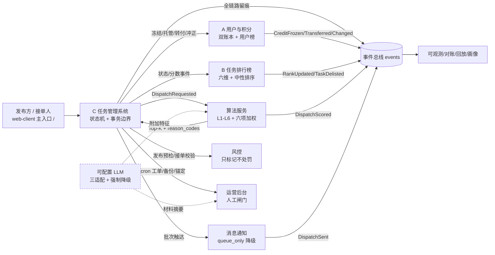

# 三宝殿 · 悬赏互助平台　模块设计说明

| 项目 | 内容 |
|---|---|
| 文档编号 | 04 |
| 文档名称 | 模块设计说明（正式评审稿） |
| 版本号 | v1.0 |
| 编制日期 | 2026-11-19 |
| 适用形态 | Web 单端 · Cloudflare Pages Functions + D1（SQLite 方言） |
| 口径基线 | `CONTRACT.md` v0.2（术语/状态机/事件/权重唯一契约）、`三宝殿项目方案_v1.0.md` §4、D-10～D-14 裁决 |
| 实现真源 | `prod/lib/domain.js`、`prod/lib/api.js`、`prod/lib/schema.js` 及支撑模块 |
| 配套文档 | `05-数据库设计.md`、`06-接口设计.md`、`docs/12-生产系统架构与部署.md`、`docs/13-完全体能力与运营就绪.md` |
| 状态说明 | 本文描述**代码能力口径**；正式运营许可须外部 20 项证据核销（`docs/13` §5，当前 0/20 → NOT READY），二者不得混同 |

---

## 目录

1. [概述与范围](#1-概述与范围)
2. [模块总览与边界](#2-模块总览与边界)
3. [模块 A：用户与积分管理（SBC）](#3-模块-a用户与积分管理sbc)
4. [模块 B：悬赏任务排行榜](#4-模块-b悬赏任务排行榜)
5. [模块 C：任务管理系统](#5-模块-c任务管理系统)
6. [支撑模块](#6-支撑模块)
7. [模块联动关系与事件清单](#7-模块联动关系与事件清单)
8. [用户版前端模块（web-client）](#8-用户版前端模块web-client)
9. [口径版本与变更](#9-口径版本与变更)

---

## 1. 概述与范围

### 1.1 本文定位

本文描述「三宝殿 · 悬赏互助平台」生产系统的**模块职责、边界、内部机制与联动关系**，面向产品、研发、法务三方评审。口径严格对齐 `CONTRACT.md` v0.2 与 `prod/lib/` 源码，权重、状态值、事件名、科目名均可量化、可逐项追溯到源码常量。

### 1.2 本期范围（D-13 / D-14 定稿）

- **做**：生产系统 Web 主入口 `/`（面向 Publisher / Solver 的真实用户产品站）、后端 41 个 HTTP 端点、D1 持久化、会话/CSRF/RBAC、账本哈希链与 Merkle 锚定、通知/LLM/cron/风控/可观测/运维灾备模块；内部操作台保留在 `/prod`，L0 演示台保留在 `/index`。
- **不做**：真实法币支付、公链存证、自动结算、跨区域多活、SBC 转让/交易/兑付/收益（红线路径一律 404）；真实年龄核验与律师书面复核（外部闸门，V8 / `docs/13`）。
- **口径不变**：G1–G7 数值、三套权重、14 状态机、积分公式、§8 契约端点路径、§10 全部红线、D-01～D-14 任一裁决均不改写。

### 1.3 关键版本常量（源码真值）

| 常量 | 值 | 来源 |
|---|---|---|
| `SERVICE` / `VERSION` | `sambon-production` / `v3.0.0` | `api.js` |
| `SCHEMA_VERSION` | `sambon-prod-schema-v2.0` | `schema.js` |
| `RULE_VERSION` | `sbc-rule-v1.0` | `domain.js` |
| `WEIGHT_VERSION` / `RANK_WEIGHT_VERSION` | `v1.0` / `v1.0` | `domain.js` |
| `LLM_ADAPTER_VERSION`（领域） | `llm-adapter-rule-fallback-v1.0` | `domain.js` |
| `llmMeta().version`（接入层） | `llm-adapter-v2.0` | `prod/lib/llm.js` |
| `AUTO_VERIFY_HOURS` / `DISPUTE_CLOSE_HOURS` | `24` / `72` | `domain.js` |
| `MAX_REJECT` | `2` | `domain.js` |
| `INITIAL_SBC_DEFAULT` | `1000`（生态激励池支出，非兑付） | `api.js` |

---

## 2. 模块总览与边界

### 2.1 业务模块（A/B/C）

| 模块 | 一句话职责 | 做什么 | 不做什么 | 唯一事实源 |
|---|---|---|---|---|
| **A 用户与积分管理** | 身份、SBC 双账本、等级权益、用户积分榜 | 身份与信用、SBC 发行/回收、冻结/托管/转付/冲正、五级科目记账、榜单计分、哈希链与 Merkle 摘要、对账与导出 | 不判任务状态、不算任务排序、不决定推送名单、不实现转让/交易/兑付、不上链任何 PII 或任务正文 | 积分流水 `ledger_entries` 与用户主数据 `users` |
| **B 悬赏任务排行榜** | 任务的展示排序与实时上下架 | 六维打分与排序、中性排序、事件驱动增量更新、可解释 Top3、反作弊与熔断、快照降级 | 不审核任务、不改任务状态、不结算积分、不直接决定推送名单（展示面≠分发面） | 榜单快照与权重版本 `rank_weight_version`（本轮由任务快照实时计算，无独立快照表） |
| **C 任务管理系统** | 任务全生命周期编排与事务边界 | 发布/审核、推送触发与批次编排、接单并发控制、履约提交与验收、争议入口、结算编排、归档与回放 | 不实现账本（调 A）、不实现榜单打分（发事件给 B）、不做模型推理（调算法服务）、不自建触达通道（调消息服务） | 任务状态机 `tasks.state` + `tasks.version` 乐观锁 |

### 2.2 支撑模块

| 模块 | 职责 | 做什么 | 不做什么 | 唯一事实源 |
|---|---|---|---|---|
| **算法服务** | 候选漏斗与多目标打分 | L1–L6 漏斗编排、硬过滤、类目内归一化、六项加权、Top-K 分批、可解释 reason_codes | 不让模型决定推送名单/积分结算/争议裁定 | `dispatches` + `weight_version` |
| **风控** | 风险标记与登录保护 | 发布行为评分、登录失败锁定、`risk_flags` 落库、人工处置 | `blocked` 恒 false：不自动拦截任务、不自动处罚、不改任务状态 | `risk_flags` |
| **消息通知** | 统一通知队列与可配置投递 | 入队 `PENDING`、Webhook HMAC 签名投递、失败重试至 5 次、已读管理 | 未配置时不得自称已发送（`queue_only` 降级） | `notifications` |
| **可配置 LLM** | 三适配接口真实调用与强制降级 | OpenAI-compatible 调用、输入脱敏、超时/异常降级 | 输出恒 `model_decision:null`，不写事件/日志、不进决策 | 无状态；降级结果由领域规则兜底 |
| **定时任务（cron）** | HTTP 触发的 5 作业 | 到期打标、清理、锚定、通知投递、逐作业错误隔离 | 只生成待人工确认工单，绝不自动结算或自动裁定 | `audit_log`（`CRON_*`）+ `risk_flags` |
| **可观测与审计** | 请求指标、结构化日志、账本完整性校验 | 白名单日志、指标聚合、哈希链重算、Merkle 根 | 不记录 body/header/token/cookie/email/IP | `metrics` + `audit_log` |
| **运营后台** | 人工闸门与运维视图 | 审核队列、争议队列、举报队列、风控处置、备份、锚定、运维总览 | 模型不得替代任何人工确认 | `audit_log` |

### 2.3 模块裁决原则（方案 §4.4）

> C 与 A 定义事实，算法与 B 只做「排序建议」。发生口径冲突时以 **C 的状态机**与 **A 的账本**为准，算法与榜单按事件回放重算；任何模块不得直接改写他方业务状态，跨模块调用一律携带 `task_id + event_id + version`。

---

## 3. 模块 A：用户与积分管理（SBC）

### 3.1 职责与边界

- **做**：统一身份（`users`）、SBC 发行与回收、双账本记账、冻结/托管/转付/冲正、信用分与等级权益、用户积分榜、哈希链与 Merkle 摘要、GDPR 导出/擦除、对账审计。
- **不做**：SBC 交易/转让/法币兑换/收益承诺/二级市场；普通用户自持私钥；任何 PII 或任务明文上链；公链发币/募资。
- **法律性质**（方案 §4.1.3 / CONTRACT §1）：SBC 为**平台内贡献积分凭证**，非加密资产、非证券、非支付工具，不可兑付法币、不可转让。

### 3.2 SBC 双账本模型

| 账本 | 地位 | 内容 | 当前实现 |
|---|---|---|---|
| 链下账本（权威） | 唯一权威账 | 全部实时流水 `ledger_entries`，只追加、可冲正、哈希链防篡改 | D1 表 `ledger_entries`，`postLegs()` 事务写入 |
| 存证层（校验） | 校验用摘要 | 流水哈希链 + Merkle 根 + 时间戳 + 版本号 + 前序哈希 | **本地哈希摘要 + 可插拔锚定接口**；未接任何公链、零 PII、零任务正文（D-14 明令不做公链存证） |

- 用户可在前端自查本人流水哈希与守恒结果（`GET /api/ledger/:userId` 返回 `balance_check` 与 `anchor`）。
- 链下 Merkle 根与存证摘要一致性由 `ledgerIntegrity()` 实时重算校验；T+1 对账差异必须为 0（目标口径，方案 §4.1.6）。

### 3.3 五科目与守恒

`SUBJECTS`（`domain.js`）定义五个账本科目，记为 `available / frozen / escrow / platform_revenue / eco_incentive`。

| 科目 | 含义 | 进入条件 | 离开条件 | 账户键格式 |
|---|---|---|---|---|
| `available` | 用户可用积分 | 结算转付、解冻、补偿、初始额度 | 发布冻结、处罚扣回 | `user:<user_id>`（同步更新 `users.available_sbc`） |
| `frozen` | 发布冻结 | 审核通过冻结赏金+服务费 | 接单转托管、撤回解冻 | `subject:frozen` |
| `escrow` | 接单托管 | 接单时全额转入 | 结算转付、争议退款 | `subject:escrow` |
| `platform_revenue` | 平台收入 | **仅 `SETTLED` 时**确认 5% 服务费 | 未成交不确认（D-04） | `subject:platform_revenue` |
| `eco_incentive` | 生态激励 | 初始额度、质量奖励支出来源 | 记账支出（负 delta） | `subject:eco_incentive` |

**记账铁律**（CONTRACT §5）：不可变流水只追加；冲正以反向流水实现；每条流水含 `event_id / 科目 / delta / rule_version / task_id / prev_hash / hash`；五科目 Σdelta 恒为 0（`postLegs()` 与 `ledgerIntegrity()` 双重校验，容差 `1e-6`）。

### 3.4 冻结 / 托管 / 转付 / 冲正机制

| 机制 | 触发端点 | 腿（legs）记账 | 状态/字段副作用 |
|---|---|---|---|
| **冻结** | `POST /api/tasks/:id/review`（approve） | `user:发布者 -freeze.total` ↔ `subject:frozen +freeze.total` | `state=PUBLISHED`、`frozen_total`、`version+1`；写 `CreditFrozen`+`TaskUpdated` |
| **托管** | `POST /api/tasks/:id/accept` | `subject:frozen -total` ↔ `subject:escrow +total` | `state=ACCEPTED`、`solver_id`、`escrowed=1`、`version+1`；写 `TaskAccepted`+`CreditChanged` |
| **转付（结算）** | `POST /api/tasks/:id/verify`（approve/auto_accept）、`dispute(resolve=pay_solver)` | `subject:escrow -total`、`user:接单人 +bounty`、`subject:platform_revenue +fee`，可选 `subject:eco_incentive -bonus`、`user:接单人 +bonus` | `state=SETTLED`、`settled_at`、`stats_json` 更新；写 `CreditTransferred`/`CreditChanged`/`SettlementCompleted`/`TaskDelisted`/`RankUpdated` |
| **冲正（反向流水）** | 违规扣回、争议退款、撤回退款 | 以原流水逐条取反的新流水追加，不改原流水 | 违规场景冻结账户；争议退款 `escrow → available` 全额原路退回（含 5% 服务费，D-04） |
| **撤回分账** | `POST /api/tasks/:id/cancel` | 未托管：`frozen -frozen` ↔ `user:发布者 +frozen`；已托管：`escrow -frozen` ↔ `发布者 +90%` + `接单人 +10%` | `state=REJECTED/CANCELLED`，写 `TaskCancelled`+审计 |

**冻结时点裁决（D-01）**：**审核通过进入 `PUBLISHED` 时冻结**；发布仅做合规预检 + 余额预校验，避免 `REJECTED` 产生孤立冻结。

### 3.5 积分规则表（可测口径）

| 行为 | 变动 | 触发时点 | 科目变化 | 规则常量 |
|---|---|---|---|---|
| 提交审核 | **不划转**：仅合规预检 + 余额预校验 | `POST /api/tasks` | — | `compliance-precheck-v1.0` |
| 审核通过 | 冻结赏金 + 5% 服务费 | `review(approve)` → `PUBLISHED` | 可用 → 冻结 | `SERVICE_FEE_RATE=0.05` |
| 取消（未接单） | 全额解冻（含 5% 服务费） | `cancel` | 冻结 → 可用 | D-04 |
| 取消（已接单，发布方原因） | 90% 解冻 + 10% 补偿接单人 | `cancel` | 托管 → 分账 | `CANCEL_COMPENSATION_RATE=0.10` |
| 有效完成 | 赏金转付接单人；**5% 服务费此时才计入平台收入** | `SETTLED` | 托管 → 可用/平台收入 | `computeFreeze`/`settleTask` |
| 高质量奖励 | 评价 ≥ 4.5 额外 +2% 赏金，单任务上限 50 SBC | `verify(rating)` | 生态激励支出 | `QUALITY_BONUS_RATE=0.02`、`QUALITY_BONUS_CAP=50`、`QUALITY_RATING_THRESHOLD=4.5`；**进余额、不计 `net_sbc`**（D-03） |
| 超时未完成 | 0，信用分 −5，释放冻结 | deadline / cron 提醒 | 冻结 → 可用 | `TIMEOUT_CREDIT_PENALTY=-5` |
| 争议 | 全额转托管，裁定前不转付 | `dispute(open)` | 冻结 → 托管 | `DISPUTE_CLOSE_HOURS=72` |
| 争议退款/关闭/未成交 | 赏金 + 5% 服务费全额原路退回 | `dispute(resolve)` / `cancel` | 托管 → 可用 | D-04 |
| 违规刷单 | 扣回所得（反向流水冲正）、冻结账户 | 风控裁定 + 人工 | 冲正 | 人工兜底，`decision=null` |

### 3.6 用户积分榜 RankScore 口径

`rankUsers()` 四维加权（和 = 1.00），类目内 P5–P95 截断 + min-max 归一化：

| 因子 | 权重 | 归一化方式 |
|---|---|---|
| 净获得 SBC `net_sbc` | **0.55** | `log1p` 后类目内 P5–P95 + min-max |
| 有效完成单量 `completed_count` | **0.20** | 类目内分位数 |
| 加权评价 `weighted_rating` | **0.15** | 贝叶斯平滑 `(sum + m·prior)/(n + m)`，`m=10`、`prior=4.2` |
| 准时率 `on_time_rate` | **0.10** | 直接比例；样本 < 5 单取类目先验 `0.9` |

**`net_sbc` 定稿口径（D-03）**：仅「已验收通过任务的**赏金本金**」计入；高质量奖励（+2%）、赠送、补偿、邀请、活动奖励、争议中积分一律**不计入**榜单分（防刷榜、可复算），但奖励仍进入接单人可用余额。`settleTask()` 只对 `stats_json.net_sbc` 累加 `bounty`。权重版本 `rank_weight_version=v1.0`；变更须评审 + 公示 7 天；付费置顶不得进入自然排序。

### 3.7 反作弊与权益封顶

| 项 | 口径 |
|---|---|
| 同组合频次 | 同一发布方—接单人组合周期频次上限 |
| 关联排除 | 关联账号/设备/IP 排除；`hardFilter()` 的 `RELATED_PARTY` 与 `RISK_BLACKLIST` 硬拦截 |
| 异常增速 | 异常增速检测命中则降权或剔除并回溯重算 |
| 权益封顶 | 榜单名次/等级带来的**推送加权封顶总分 5%**（`LEVEL_BOOST_CAP=0.05`，`LEVEL_BOOST_CAPPED_5PCT`）；服务费减免、展示位等权益**不得折算现金** |
| 更新机制 | 积分事件驱动增量更新（目标 P95 ≤ 10s）+ T+1 全量校准；作弊回收后回溯重算并公示；提供申诉通道 |

---

## 4. 模块 B：悬赏任务排行榜

### 4.1 职责与边界

- **做**：六维打分与排序、按城市/类目/时间窗分片展示、实时上/下架、权重版本管理、可解释 Top3、反作弊与熔断、与推送的阻尼联动。
- **不做**：不审核任务内容、不改任务状态、不结算积分、**不直接决定推送名单**（展示面与分发面共享特征，但互不阻塞）。
- **实现形态**：本轮由 `rankTasks()` 对 `tasks` 快照实时计算，关闭个性化时走 `hLeaderboardTasks()` 的时间+距离中性排序；无独立榜单快照表（方案中的「榜单快照」为逻辑视图）。

### 4.2 六维权重表（`TASK_RANK_WEIGHTS`，和 = 1.00）

| # | 维度 | 权重 | 计算口径（源码/方案） | 方向 | 数据源 |
|---|---|---|---|---|---|
| 1 | 悬赏价值 `value` | **0.25** | `log1p(bounty / 类目中位数)` | 正向 | 任务系统 |
| 2 | 紧迫度 `urgency` | **0.20** | `1 - remaining_ratio`，剩余 < 0.3 额外 +0.3 | 正向 | 任务系统（实时） |
| 3 | 完成可行性 `feasibility` | **0.20** | `0.55 + qualified_solver_ratio × 0.5` | 正向 | 离线特征 + 实时供给 |
| 4 | 发布方信用 `publisher_credit` | **0.15** | `publisher_credit_score / 100` | 正向 | 用户模块 |
| 5 | 热度/竞争度 `heat` | **0.10** | `0.6 - exposure_accept_ratio × 0.05`，过度竞争反向降权 | 双向 | 埋点（近实时） |
| 6 | 质量与清晰度 `quality` | **0.10** | `structure_completeness`（LLM 结构化完整度） | 正向 | 算法服务 |
| | **合计** | **1.00** | | | |

### 4.3 归一化口径

- 六维在**同类目内**做 P5–P95 截断 + min-max 归一化（`normalizeInCategory()`），全组同值返回 0.5 中性值，避免高价类目霸榜。
- 排序分数 `rank_score = Σ weight × 归一化值`，保留 4 位小数；同分按 `task_id` 字典序稳定排序。
- **争议中任务打标降权 50%**（`score *= 0.5`，保留展示不消失）；终态 `CANCELLED/EXPIRED/CLOSED/REJECTED/DISCARDED` 任务不参与榜单。
- 付费置顶**不进入自然排序**；广告位独立分区且显著标注（本轮不实现广告位）。
- 每条输出 `top_factors`（Top3 影响因子及贡献值）、`factors`（六维明细），可解释可复算。

### 4.4 时效性 SLA（方案 §4.2.3 目标口径）

| 变更类型 | 榜单生效延迟 |
|---|---|
| 已接单 / 已完成 / 下架 / 争议降级 | ≤ 1s（P95） |
| 分数类变更（热度、紧迫度、价值调整） | ≤ 5s（P95） |
| 全量校准与权重版本切换 | ≤ 15 min，需公告 |
| 榜单与任务状态最终一致 | ≤ 5s |

### 4.5 降级机制

- 缓存或打分器故障时降级展示**上一次成功快照**并显式标注快照时间，`deadline` 已过/已下架/已冻结/已完成任务绝不展示；故障恢复后按事件回放补齐。
- 关闭个性化（账号级或浏览器 GPC/DNT）后走**中性排序**：只按 `registered_at`（时间）+ `radius_km`（距离），`rank_score=null`、`reason_codes` 仅 `NEUTRAL_TIME`/`NEUTRAL_DISTANCE`，服务端强制、客户端不可覆盖。
- 任务榜与算法服务互不阻塞：任一方故障不影响另一方闭环。

### 4.6 与推送联动及阻尼

- 榜单分作为召回特征之一（**非唯一，权重不超过精排总分 10%**，与 `LEVEL_BOOST_CAP` 一致）。
- 推送产生的曝光/接单反馈回流榜单热度（`DispatchExposed`/`DispatchIgnored`/`TaskAccepted`）。
- **阻尼控制**：设置曝光上限与阻尼系数，**热度项单轮涨幅 ≤ 20%**，防止「高榜 → 高推 → 更高榜」正反馈失控；异常流量触发分片熔断。

---

## 5. 模块 C：任务管理系统

### 5.1 职责与边界

- **做**：发布与审核、推送触发与批次编排、接单并发控制、履约提交与验收、争议入口、结算编排、全链路回放。
- **不做**：不实现账本、不实现榜单打分、不做模型推理、不自建触达通道。它是**编排层**，负责定义事务边界、幂等与超时。
- **并发与幂等铁律**：服务端原子锁 + 先到先得（竞赛制多中标为例外）；所有状态迁移携带 `event_id`，重复请求返回原结果不产生副作用；非法迁移数必须为 0。

### 5.2 状态机（14 状态，唯一事实源在 C）

`STATE_MACHINE`（`domain.js`）：

| 状态 | 含义 | 合法后继 | 超时规则 |
|---|---|---|---|
| `DRAFT` | 发布方草稿 | `PENDING_REVIEW` / `DISCARDED` | 7 天未提交自动清理 |
| `PENDING_REVIEW` | 待平台审核（合规预检 + 人工抽检） | `PUBLISHED` / `REJECTED` | 审核 ≤ 30 min，超时告警转人工 |
| `PUBLISHED` | 已发布、赏金已冻结 | `DISPATCHING` / `CANCELLED` | 24h 未启动推送告警 |
| `DISPATCHING` | 推送批次执行中 | `ACCEPTED` / `EXPIRED` / `CANCELLED` | 达扩量上限转运营干预 |
| `ACCEPTED` | 接单锁定（赏金托管） | `IN_PROGRESS` / `CANCELLED` / `EXPIRED` | 独占 3 min（S2 15 min） |
| `IN_PROGRESS` | 履约中 | `SUBMITTED` / `EXPIRED` / `DISPUTED` | 按 deadline，剩余 20% 提醒 |
| `SUBMITTED` | 成果待验收 | `SETTLED` / `DISPUTED` / `IN_PROGRESS`（驳回 ≤2 次） | 24h 未操作 → 自动验收（手动触发） |
| `DISPUTED` | 仲裁中（积分托管） | `SETTLED` / `CANCELLED` / `CLOSED` | 72h 内结案 |
| `SETTLED` | 已结算完成 | `CLOSED` | 结算回写 ≤ 10s |
| `REJECTED` | 审核拒绝（终态） | — | 归档 |
| `CANCELLED` | 已撤回（终态） | — | 归档，评价期 7 天 |
| `EXPIRED` | 已过期（终态） | — | 归档 |
| `CLOSED` | 已关闭（终态） | — | 归档 |
| `DISCARDED` | 已丢弃草稿（终态） | — | 归档 |

> 注：CONTRACT §3 表述为「13 状态 + 丢弃」，源码 `STATE_MACHINE` 显式登记 14 个状态（含 `DISCARDED` 终态），本设计以源码为准并如实标注。

### 5.3 五环节闭环

| 环节 | 关键动作 | 输入 / 输出契约 | 联动 |
|---|---|---|---|
| 1 发布 | 必填校验、违禁词预检、LLM 结构化、余额预校验 | 出 `task_id` + `TaskPublished`（`PENDING_REVIEW`） | A 预校验、算法取特征、风控预检 |
| 2 后台推送 | 审核通过 → `DispatchRequested`；算法 Top-K + 策略 + `weight_version`；分批触达；dry-run 预览 | 出 `DispatchScored`/`DispatchSent` | 算法服务、消息服务、风控 |
| 3 接单 | 独占窗口内接单，校验资质/信用/负载/关联；转托管 | 出 `TaskAccepted` → `ACCEPTED`/`escrowed=1` | A 托管、B ≤1s 下榜、算法回收反馈 |
| 4 结果反馈 | 提交成果（PII 脱敏）、通过/驳回（≤2 次）、超时自动验收、争议人工仲裁 | 出 `TaskSubmitted`/`TaskVerified`/`DisputeOpened` | A 保持托管、B 争议降权 |
| 5 积分核算 | 结算编排（无 `SettlementRequested`，D-02）→ A 生成流水 → 回写 `SETTLED` → 广播 | 出 `CreditTransferred`/`CreditChanged`/`SettlementCompleted` | A 记账、B 更新榜单、算法标签、画像 |

### 5.4 并发 CAS 与幂等

- **CAS 抢单闸门**：`hAccept()` 先执行 `UPDATE tasks SET version=version+1 WHERE task_id=? AND state='DISPATCHING' AND version=?`，`changes !== 1` 即抛 `CONCURRENT_CONFLICT`（409）。与仅事后检查 state 相比，避免败者仍写入孤立托管流水；完成后再校验 `after.state==='ACCEPTED'` 二次兜底。
- **乐观锁覆盖**：`accept` / `verify` / `settleTask` / `cancel` 均递增 `version`，`cancel` 使用 `WHERE task_id=? AND version=?` 条件更新。
- **幂等闸门**：`withIdempotency()` 以 `event_id`（≤128 字符）为 PRIMARY KEY；命中 `done` 重放缓存响应并置 `X-Idempotent: replayed`；`pending` 返回 `IDEMPOTENCY_IN_PROGRESS`（409）；业务失败释放 pending 允许重试。

### 5.5 事件表（生产事件集合）

运行期事件必须 ⊆ `PROD_EVENTS`（`api.js`）：

| 集合 | 事件 |
|---|---|
| 契约 §4 十八类 `CONTRACT_EVENTS` | `TaskPublished`、`TaskUpdated`、`RiskBlocked`、`CreditFrozen`、`CreditChanged`、`CreditTransferred`、`RankUpdated`、`DispatchRequested`、`DispatchScored`、`DispatchSent`、`TaskAccepted`、`TaskSubmitted`、`TaskVerified`、`TaskDelisted`、`DisputeOpened`、`DisputeResolved`、`SettlementCompleted`、`PreferenceChanged` |
| D-13 扩展 | `ReportFiled` |
| D-14 V3 九类扩展 | `TaskCancelled`、`DispatchExposed`、`DispatchIgnored`、`EmailVerified`、`NotificationQueued`、`RiskFlagged`、`BackupCreated`、`LedgerAnchored`、`CronCompleted` |

`appendEvent()` 对未登记类型直接抛错；`safePayload()` 走键白名单 + 长数字串抹除，零 PII、零任务正文。

### 5.6 人工闸门

| 闸门 | 端点 / 条件 | 角色 | 审计动作 |
|---|---|---|---|
| 任务审核 | `POST /api/tasks/:id/review` | **admin only** | `TASK_REVIEW_MANUAL` |
| 候选推送 | `POST /api/tasks/:id/dispatch`（含 `dry_run`） | **admin only** | `DISPATCH_CONFIRMED` |
| 验收通过 | `POST /api/tasks/:id/verify`（发布方本人） | publisher | `SETTLEMENT_CONFIRMED` |
| 超时自动验收 | `verify(decision=auto_accept)` | **admin only** | `AUTO_VERIFY_MANUAL` |
| 争议裁定 | `dispute(action=resolve)` | **admin only** | `DISPUTE_RESOLVED_MANUAL` |
| 风控处置 | `POST /api/admin/risk/resolve` | **admin only** | `RISK_RESOLVED_MANUAL` |
| 账本锚定 | `POST /api/admin/anchor` | **admin only** | `LEDGER_ANCHOR_MANUAL` |
| 备份导出 | `GET /api/admin/backup` | **admin only** | `BACKUP_EXPORTED_MANUAL` |
| 定时任务 | `POST /api/admin/cron` | **`X-Cron-Secret`** | `CRON_*` |

> 模型输出恒 `model_decision:null`，不参与任何闸门裁定；可见按钮不等于授权，服务端强制校验（`enforcement: server_side`）。

---

## 6. 支撑模块

### 6.1 算法服务：漏斗 L1–L6

| 层 | 职责 | 产出规模（基线） | 本轮实现 |
|---|---|---|---|
| L1 硬过滤 | 资质、围栏、负载、频次、风控、关联 | 候选池 → 合规池 | ✅ `hardFilter()`：`RISK_BLACKLIST`/`QUALIFICATION_MISMATCH`/`OUT_OF_RADIUS`/`LOAD_FULL`/`DAILY_PUSH_CAP`/`RELATED_PARTY` |
| L2 召回 | 规则召回 + 向量语义召回 | ≤ 500 | 规则召回（LBS + 类目 + 认证），向量召回属 P1 |
| L3 粗排 | 轻量规则/模型剔除低质组合 | ≤ 100 | 类目内归一化前置 |
| L4 精排 | 多目标打分 + LLM 语义匹配附加特征 | ≤ 30 | ✅ `scoreCandidates()` 六项加权 |
| L5 重排 | 去重、多样性、新人/长尾配额、疲劳阻尼 | Top-K | ✅ Top-K 截断 + 新人/长尾探索因子 |
| L6 触达编排 | 分批放量、独占窗口、通道选择 | 批次日志 | ✅ `buildBatches()` 分批元数据（首批窗口 3 min，后续 10 min） |

**多目标打分公式**（`Score(t,u)`，六项权重和恒为 1.00）：

```
Score(t,u) = 0.30·P_accept + 0.35·P_complete_on_time − 0.10·C_notify
           − 0.10·R_risk + 0.08·V_fairness + 0.07·B_supply
```

| 因子 | 权重 | 方向 | 含义 |
|---|---|---|---|
| `P_accept` | 0.30 | 正 | 独占窗口内接单概率（类目响应率） |
| `P_complete_on_time` | 0.35 | 正 | 按时且验收通过概率（准时率 × 难度 × 剩余时长） |
| `C_notify` | 0.10 | 负 | 打扰成本（疲劳度 0.6 + 忽略率 0.4 + 当日推送占比 0.3） |
| `R_risk` | 0.10 | 负 | 纠纷/作弊/安全风险（由信用分反推） |
| `V_fairness` | 0.08 | 正 | 新人/长尾探索曝光 |
| `B_supply` | 0.07 | 正 | 区域供需分段函数（0.2/0.3/0.5/0.75/0.95） |

- 各项先 P5–P95 截断 + min-max 归一化再加权；等级/榜单加权封顶 5%（`LEVEL_BOOST_CAP`）；每条命中输出 `reason_codes` 并落库。
- 派单策略：S1 本地即时 K=8/独占 3 min；S2 技能型 K=12/独占 15 min；S3 众包竞赛 K=30 分批广播；deadline 剩余 <30% 触发加速。
- 打扰控制：日推送上限基线 20（≤30）、同类目最小间隔 30 min、免打扰 23:00–07:00、长尾曝光占比 ≥20%、探索池 10%。

### 6.2 LLM 角色边界

- **三个可替换适配接口**（`domain.js`）：`extractTaskStructure()`（结构化抽取与质量评分）、`semanticMatchHint()`（语义匹配附加特征）、`summarizeDispute()`（争议摘要，辅助人工）。
- **可配置真实接入**（`prod/lib/llm.js`）：OpenAI-compatible Chat Completions；未配置 `LLM_API_URL`/`LLM_API_KEY`、非 2xx、超时（4000 ms）、异常一律降级为领域规则兜底；输入经 `sanitizeSubmissionText()` 脱敏并截断 800 字符；输出恒 `model_decision:null`；不写事件 payload 或日志。
- **红线**：模型**不决定**最终推送名单、积分结算、争议裁定、任务下架；模型不可用自动降级规则引擎，推送不中断。

### 6.3 风控（`prod/lib/risk.js`）

| 规则 | 阈值 | 分数 |
|---|---|---|
| 5 分钟内发布 ≥5 单 | `HIGH_FREQUENCY_PUBLISH` | 0.6 |
| 单笔赏金 > 10000 | `ABNORMAL_BOUNTY` | 0.5 |
| 标题/描述含引流诱导词 | `SUSPECT_SOLICITATION` | 0.8 |
| 同标题 24h 内重复 ≥3 次 | `DUPLICATE_TASK` | 0.4 |

- 总分封顶 1，`blocked` **恒 false**：只标记、不自动拦截、不自动处罚、不改任务状态；违禁词一票否决由 `compliancePrecheck()` 在发布时执行。
- 登录保护：连续失败 5 次锁定 15 分钟（`ACCOUNT_LOCKED` 423），属会话保护非业务处罚。
- 全部处置经 `POST /api/admin/risk/resolve`（`dismiss`/`escalate`）人工确认。

### 6.4 通知（`prod/lib/notify.js`）

- 统一入队 `PENDING`，对外投递由 `deliverPending()` 显式驱动；仅 2xx 置 `SENT`，失败累加 `attempts`，第 5 次置 `FAILED`。
- Webhook 配置 `NOTIFY_WEBHOOK_URL` + HMAC-SHA256 签名 `x-sambon-signature`；超时 4000 ms。
- **降级**：未配置时返回 `degraded:true, channel:'queue_only', sent:0`，绝不伪造已发送。
- 正文兜底抹除 6 位以上连续数字 + 300 字截断；`EMAIL_VERIFICATION` 令牌为随机 hex 非 PII、原样送达。

### 6.5 定时任务（`prod/lib/jobs.js`）：只出工单

由 `POST /api/admin/cron` 带 `X-Cron-Secret` 触发，顺序执行 5 作业、逐作业隔离错误：

| 作业 | 行为 | 是否自动改状态 |
|---|---|---|
| `auto_verify_due` | SUBMITTED 到期打 `AUTO_VERIFY_DUE` 标记 + 通知发布方 | ❌ 仅提醒，人工确认后结算 |
| `dispute_due` | DISPUTED 到期打 `DISPUTE_CLOSE_DUE` + 通知全部 admin | ❌ 仅提醒，人工裁定 |
| `cleanup` | 清理过期会话（到期即删）、幂等键（30d）、已读通知（30d）、已验证邮箱（7d）、限流桶（1h） | 仅清理辅助数据 |
| `anchor` | 计算 Merkle 根写 `meta.ledger_anchor`，不改流水 | 否 |
| `notify_delivery` | 调用 `deliverPending()` 真实/降级投递 | 否 |

`dry_run=true` 只统计不写入（含 `audit_log` 也不写）；所有到期项进 admin 人工闸门。

### 6.6 可观测与审计（`prod/lib/observability.js`）

- `structuredLog()` 仅输出白名单字段（ts/level/event/request_id/method/path/status/duration_ms/code），仅 5xx 输出 error 日志。
- `recordMetric()` 落 `metrics`，`metricsSummary()` 聚合请求量、错误率、P95/P50 延迟、限流命中、账本完整性。
- `ledgerIntegrity()` 按 `postLegs()` 真实公式逐条重算 SHA-256、校验链连续性与五科目守恒，输出 `balanced/entry_count/total/merkle_root/hash_chain_valid`。

---

## 7. 模块联动关系与事件清单

### 7.1 联动关系图（Mermaid）



### 7.2 端到端事件流（编号基线，方案 §5.1）

1. 发布方提交 → C 生成 `task_id`，LLM 抽取结构化特征，风控预检；
2. 审核通过 → C 调 A 冻结「赏金 + 5% 服务费」→ A 写 `CreditFrozen`；
3. C 状态 `PUBLISHED`，发 `TaskPublished`；B 计算 RankScore 并上架；
4. C 发 `DispatchRequested` → 算法产出 Top-K + 策略 + `weight_version`；
5. 消息服务按批次触达，落 `DispatchSent`（候选/分数/reason_codes 全留痕）；
6. 客户端回传曝光/忽略/接单请求（`DispatchExposed`/`DispatchIgnored`/`TaskAccepted`）；
7. CAS 判定首个有效接单 → `ACCEPTED`；A 将冻结转托管；B ≤1s 下榜；
8. 接单人提交成果 → `SUBMITTED`；发布方验收/驳回/超时自动验收；
9. 通过 → C 编排结算（无 `SettlementRequested`）→ A 按规则生成流水；
10. A 回写 → `SETTLED`；广播 `SettlementCompleted`/`CreditChanged`；
11. B 更新热度与下架、用户榜增量更新、算法写训练标签；人工/ cron 触发 Merkle 锚定。

### 7.3 事件清单（产生方 / 消费方）

| 事件 | 产生方 | 主要消费方 | 本轮状态 |
|---|---|---|---|
| `TaskPublished` / `TaskUpdated` | C | B、算法、风控 | 已产生 |
| `CreditFrozen` / `CreditTransferred` / `CreditChanged` | A | C、B、对账 | 已产生 |
| `DispatchRequested` / `DispatchScored` / `DispatchSent` | C / 算法 | 消息、埋点、回放 | 已产生 |
| `TaskAccepted` | 客户端 | 算法、B 热度、疲劳度 | 已产生 |
| `DispatchExposed` / `DispatchIgnored` | 客户端回执 | 算法、B 热度、疲劳度 | 已产生（`feedback` 端点） |
| `TaskSubmitted` / `TaskVerified` / `DisputeOpened` / `DisputeResolved` | C | A、B、算法标签 | 已产生 |
| `SettlementCompleted` | C → A | B、画像、看板 | 已产生 |
| `RankUpdated` / `TaskDelisted` | B | 客户端、大屏 | 已产生 |
| `LedgerAnchored` | A | 用户自查、审计 | 已产生（`admin/anchor`） |
| `RiskBlocked` / `PreferenceChanged` | 风控 / 偏好 | 审计、运营 | 已产生 |
| `ReportFiled` | 合规 | 运营举报队列 | 已产生 |
| `TaskCancelled` / `EmailVerified` / `NotificationQueued` / `RiskFlagged` / `BackupCreated` / `CronCompleted` | 各模块 | 运营/审计/通知 | 已产生 |

---

## 8. 用户版前端模块（web-client）

### 8.1 定位与职责

| 项 | 说明 |
|---|---|
| 定位 | 面向**真实 Publisher / Solver** 的悬赏平台 Web 产品站，作为站点主入口 `/` |
| 与现有入口关系 | 主入口 `/`（本模块）→ 用户版；`/prod`（现有 `prod/site`）→ 内部操作台 / 运营后台；`/index`（`cloudflare/index.html`）→ L0 演示台。三者互不干扰，由 `cloudflare/_redirects` 控制 |
| 职责 | 注册/登录/邮箱验证、任务浏览与搜索、发布任务、接单与履约、成果提交、验收与争议、榜单浏览、账本自查、通知中心、偏好与 i18n、GDPR 权利行使 |
| 不做什么 | 不做服务端鉴权决策（仅展示，服务端强制 `enforcement: server_side`）、不实现账本/排序/打分、不承载任何模型裁定、不采集真实手机号/证件/精确定位 |
| 技术约束 | Cloudflare Pages 纯静态托管；调用同源 `/api/*`；会话 Cookie `sambon_sid`（httpOnly）；写操作携带 `X-CSRF-Token`；`GET /api/auth/me` 取 `csrf_token` |

### 8.2 页面与组件划分

| 页面视图（路由） | 核心组件 | 主要端点 | 角色 |
|---|---|---|---|
| 首页 / 任务大厅 | 任务列表、筛选（类目/状态/线上）、任务卡、榜单入口 | `GET /api/tasks`、`GET /api/leaderboard/tasks` | 公开浏览 / 登录交互 |
| 认证 | 登录/注册表单、邮箱验证、GPC 提示 | `POST /api/auth/register`、`login`、`verify-email`、`resend-verification` | 未登录 |
| 任务详情 | 任务信息、验收标准、虚拟号占位、成果预览 | `GET /api/tasks`（按 id 过滤/详情）、`GET /api/leaderboard/tasks` | 登录 |
| 发布任务 | 发布表单（含验收标准/难度/技能标签）、合规提示、余额校验提示 | `POST /api/tasks` | publisher / admin |
| 我的任务（发布方） | 我发布的、审核状态、验收操作、撤回、发起争议 | `POST /api/tasks/:id/{verify,dispute,cancel}` | publisher |
| 我的任务（接单方） | 待接任务、推送预览、接单、提交成果、曝光/忽略回执 | `POST /api/tasks/:id/{accept,submit,feedback}` | solver |
| 排行榜 | 任务榜、用户积分榜、权重版本说明、Top3 因子 | `GET /api/leaderboard/{tasks,users}` | 登录 |
| 账本与积分 | 本人流水、守恒校验、Merkle 摘要自查 | `GET /api/ledger/:userId` | 本人 / admin |
| 通知中心 | 通知列表、未读计数、标记已读 | `GET /api/me/notifications`、`POST /api/me/notifications/read` | 登录 |
| 账号与偏好 | 个人资料、个性化开关、语言切换、导出/注销 | `GET /api/auth/me`、`POST /api/preferences/personalized`、`/api/me/locale`、`GET /api/me/export`、`DELETE /api/me` | 登录 |
| 争议中心 | 争议发起、材料摘要展示（模型仅摘要）、裁定结果查看 | `POST /api/tasks/:id/dispute` | 相关方 / admin |

### 8.3 数据流与约束

- 所有写操作统一在入口 `api()` 注入 `X-CSRF-Token`（来自 `GET /api/auth/me` 的 `csrf_token`），并带 `credentials: 'include'` 维持 `sambon_sid`；写端点必须幂等 `event_id` 由客户端生成。
- 服务端强制项（个性化开关、GPC、角色、状态）不在前端做授权判断；前端按钮仅作交互提示，禁用态需与服务端校验结果一致。
- 所有展示的 `title/body` 走 `safeText` 同类兜底；前端不回显任何明文 PII。
- 完整的「页面视图 → 端点」映射与请求/响应规格见 `06-接口设计.md` §4、§3。

---

## 9. 口径版本与变更

| 版本 | 日期 | 变更 | 依据 |
|---|---|---|---|
| v1.0 | 2026-11-19 | 首版评审稿：A/B/C + 7 支撑模块 + web-client；对齐 CONTRACT v0.2 与 `prod/lib/` 源码 | 本次任务 |

> 本文所含数值（权重/状态/阈值/科目）严格对齐 `CONTRACT.md` v0.2 与源码；如与历史 L0 文档（`docs/02`）表述不一致，以生产系统源码为准并按 D-13/D-14 裁决说明。本文不构成运营许可，正式发布以 `docs/13` §5 的 20/20 证据与有权签字人书面 Go 决定为准。
