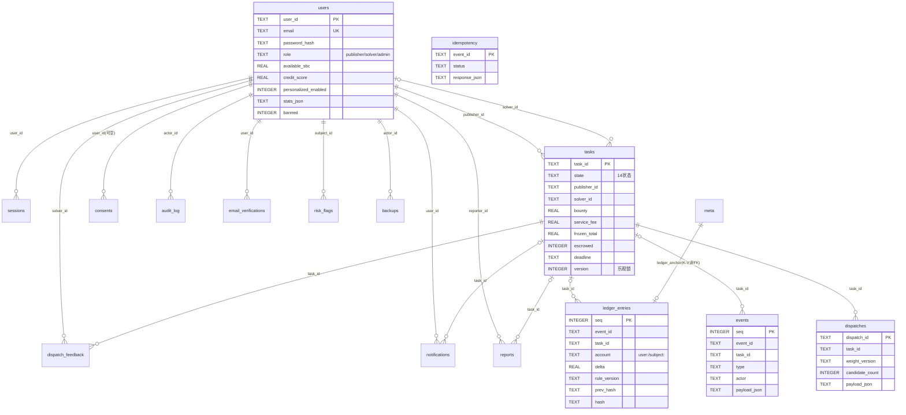

# 三宝殿 · 悬赏互助平台　数据库设计

| 项目 | 内容 |
|---|---|
| 文档编号 | 05 |
| 文档名称 | 数据库设计（正式评审稿） |
| 版本号 | v1.0 |
| 编制日期 | 2026-11-19 |
| 适用形态 | Web 单端 · Cloudflare Pages Functions + D1（SQLite 方言） |
| 唯一真源 | `prod/lib/schema.js`（`SCHEMA_VERSION='sambon-prod-schema-v2.0'`），由 `tools/build-cloudflare.mjs` 生成根目录 `schema.sql` |
| 口径基线 | `CONTRACT.md` v0.2、`三宝殿项目方案_v1.0.md` §4/§5、`docs/12` §2/§4、`docs/13` |
| 配套文档 | `04-模块设计说明.md`、`06-接口设计.md` |
| 状态说明 | 本文描述**代码能力口径**；正式运营许可须外部证据核销（`docs/13` §5，当前 0/20 → NOT READY） |

---

## 目录

1. [设计原则](#1-设计原则)
2. [逻辑数据模型（ER 图）](#2-逻辑数据模型er-图)
3. [逐表字段说明](#3-逐表字段说明)
4. [关键流程数据流转](#4-关键流程数据流转)
5. [账本哈希链与 Merkle 锚定结构](#5-账本哈希链与-merkle-锚定结构)
6. [数据留存与治理](#6-数据留存与治理)
7. [迁移与版本](#7-迁移与版本)

---

## 1. 设计原则

| # | 原则 | 落地方式 |
|---|---|---|
| 1 | **单一事实源** | 所有 DDL 仅在 `prod/lib/schema.js` 定义，`schema.sql` 为生成物；`db.ensureSchema()` 首次请求自举（`CREATE TABLE IF NOT EXISTS`），本地回归用 `node:sqlite` 执行同一 SQL，不搞第二套口径 |
| 2 | **不可变流水** | `ledger_entries` 只追加（`seq AUTOINCREMENT`），冲正以反向流水实现；`events` 同样只追加；账本五科目 Σdelta 恒为 0 |
| 3 | **PII 最小化** | 不采集明文手机号/证件号/精确定位；联系方式一律虚拟号占位；成果正文先 `sanitizeSubmissionText()` 脱敏后落 `tasks.result_text`；事件 payload 走键白名单 + 长数字串抹除 |
| 4 | **零 PII 上链** | 账本锚定只做本地哈希摘要（SHA-256 + Merkle），"上链"数据为哈希与元数据，`pii_on_chain=false`、`task_body_on_chain=false`（D-14 明确不做公链存证） |
| 5 | **幂等列** | `idempotency.event_id` 为 PRIMARY KEY，是并发写入第一道闸门；写端点统一 `event_id`；`ledger_entries.event_id` 记录来源事件 |
| 6 | **乐观锁 CAS** | `tasks.version INTEGER DEFAULT 1`，接单/验收/结算/撤回用 `WHERE version=?` 条件更新，防并发抢单产生孤立托管流水 |
| 7 | **凭据只存摘要** | 会话 `sessions.token_hash` 仅存 SHA-256（Cookie 值泄露也无法冒用）；`email_verifications.token_hash`、`users.password_hash`（PBKDF2 派生值）均非明文 |
| 8 | **软删除与可恢复** | `users.deleted_at` 支持 GDPR 匿名化；任务状态终态归档不物理删除 |

> **实体范围说明**：任务需求中列举的 `leaderboard 快照`、`anchor`、`retry_queue`、`jobs` 在**本轮源码中无独立表**。榜单为 `rankTasks()` 实时计算（逻辑视图）；锚点存入 `meta.key='ledger_anchor'`（K-V）；定时任务通过 HTTP cron 编排，工单落在 `risk_flags` + `audit_log`；无重试队列表（事件为同步 `db.batch` 事务写入）。本文严格以 `schema.js` 实际 18 张表为准，不编造字段。

---

## 2. 逻辑数据模型（ER 图）

**实体分组**：

| 分组 | 表 | 说明 |
|---|---|---|
| 元数据 | `meta` | K-V，存 `schema_version`、`ledger_anchor` |
| 身份与会话 | `users`、`sessions`、`email_verifications`、`consents` | 账号、会话摘要、邮箱验证、同意留痕 |
| 任务域 | `tasks`、`dispatches`、`dispatch_feedback` | 任务主数据、推送批次、曝光/忽略回执 |
| 账本域 | `ledger_entries` | 不可变流水 + 哈希链 |
| 事件与幂等 | `events`、`idempotency` | 事件总线、幂等键 |
| 合规与治理 | `reports`、`audit_log`、`risk_flags` | 举报、人工动作审计、风控标记 |
| 通知 | `notifications` | 通知队列与投递状态 |
| 运维 | `rate_limits`、`metrics`、`backups` | 限流桶、指标、备份留痕 |

> 说明：源码 DDL 未声明物理 `FOREIGN KEY` 约束，上图关系为**逻辑关联**（由应用层保证引用完整性），避免 D1 批量写入时的外键顺序问题。

---

## 3. 逐表字段说明

> 类型与约束严格摘自 `prod/lib/schema.js` 的 `SCHEMA_STATEMENTS`；`*` 表示 v2.0 新增列（通过 `COLUMN_MIGRATIONS` 对 v1.0 库补列）。

### 3.1 `meta` — 元数据 K-V

| 字段 | 类型 | 约束 | 含义 |
|---|---|---|---|
| `key` | TEXT | PRIMARY KEY | 键：`schema_version`、`ledger_anchor` |
| `value` | TEXT | NOT NULL | 值（JSON 或字符串） |

索引：主键自带。

### 3.2 `users` — 用户主数据

| 字段 | 类型 | 约束 | 含义 |
|---|---|---|---|
| `user_id` | TEXT | PRIMARY KEY | 用户唯一标识 `U-*` |
| `email` | TEXT | NOT NULL UNIQUE | 登录邮箱（小写规范化） |
| `password_hash` | TEXT | NOT NULL | PBKDF2-SHA256 派生值（120000 轮），非明文 |
| `salt` | TEXT | NOT NULL | 16 字节随机盐 |
| `role` | TEXT | NOT NULL, CHECK IN ('publisher','solver','admin') | 角色 |
| `display_name` | TEXT | NOT NULL | 显示名 |
| `available_sbc` | REAL | NOT NULL DEFAULT 0 | 可用 SBC（由账本 `user:*` 腿同步更新） |
| `credit_score` | REAL | NOT NULL DEFAULT 100 | 信用分 |
| `personalized_enabled` | INTEGER | NOT NULL DEFAULT 1 | 账号级个性化开关（服务端强制） |
| `stats_json` | TEXT | NOT NULL DEFAULT '{}' | 画像/统计 JSON（skills、net_sbc、completed_count 等） |
| `banned` | INTEGER | NOT NULL DEFAULT 0 | 封禁标记 |
| `created_at` | TEXT | NOT NULL | 创建时间 ISO |
| `deleted_at` | TEXT | 可空 | 注销时间（软删除） |
| `email_verified` * | INTEGER | NOT NULL DEFAULT 0 | 邮箱验证状态 |
| `locale` * | TEXT | NOT NULL DEFAULT 'zh-CN' | 语言（`zh-CN`/`en`） |
| `gpc_enabled` * | INTEGER | NOT NULL DEFAULT 0 | 浏览器 GPC/DNT 信号落库 |
| `failed_logins` * | INTEGER | NOT NULL DEFAULT 0 | 连续登录失败次数 |
| `locked_until` * | TEXT | 可空 | 账号锁定到期时间 |
| `last_seen_at` * | TEXT | 可空 | 最近活跃时间 |
| `password_changed_at` * | TEXT | 可空 | 口令变更时间 |

索引：主键 `user_id`、唯一索引 `email`；`sessions(user_id)` 间接支撑。

### 3.3 `sessions` — 会话（仅摘要）

| 字段 | 类型 | 约束 | 含义 |
|---|---|---|---|
| `token_hash` | TEXT | PRIMARY KEY | 会话 token 的 SHA-256（原始 token 只随 Cookie 下发） |
| `user_id` | TEXT | NOT NULL | 所属用户 |
| `csrf` | TEXT | NOT NULL | CSRF 双提交令牌 |
| `expires_at` | TEXT | NOT NULL | 过期时间（TTL 24h） |
| `created_at` | TEXT | NOT NULL | 创建时间 |

索引：`idx_sessions_user ON sessions(user_id)`。

### 3.4 `tasks` — 任务主数据（状态机事实源）

| 字段 | 类型 | 约束 | 含义 |
|---|---|---|---|
| `task_id` | TEXT | PRIMARY KEY | 任务唯一标识 `T-*` |
| `state` | TEXT | NOT NULL | 14 状态之一 |
| `publisher_id` | TEXT | NOT NULL | 发布方 |
| `solver_id` | TEXT | 可空 | 接单方（接单后写入） |
| `title` | TEXT | NOT NULL | 标题（≤200 字符） |
| `description` | TEXT | NOT NULL | 描述（≤5000 字符） |
| `category` | TEXT | NOT NULL | 类目 |
| `bounty` | REAL | NOT NULL | 赏金本金 |
| `service_fee` | REAL | NOT NULL DEFAULT 0 | 5% 服务费 |
| `frozen_total` | REAL | 可空 | 冻结总额（赏金+服务费） |
| `acceptance_criteria` | TEXT | NOT NULL | 验收标准 |
| `virtual_contact` | TEXT | NOT NULL | 虚拟号占位，绝不存真实联系方式 |
| `reject_count` | INTEGER | NOT NULL DEFAULT 0 | 驳回次数（≤2） |
| `submit_count` | INTEGER | NOT NULL DEFAULT 0 | 提交次数 |
| `escrowed` | INTEGER | NOT NULL DEFAULT 0 | 是否已托管 |
| `online` | INTEGER | NOT NULL DEFAULT 1 | 是否线上任务 |
| `radius_km` | REAL | NOT NULL DEFAULT 10 | 服务半径 |
| `deadline_hours` | REAL | NOT NULL DEFAULT 48 | 时限小时数 |
| `deadline` | TEXT | NOT NULL | deadline ISO |
| `created_at` | TEXT | NOT NULL | 创建时间 |
| `settled_at` | TEXT | 可空 | 结算时间 |
| `result_text` | TEXT | 可空 | 脱敏后成果正文 |
| `result_pii_redacted` | INTEGER | NOT NULL DEFAULT 0 | 成果是否发生 PII 脱敏 |
| `meta_json` | TEXT | NOT NULL DEFAULT '{}' | 扩展 JSON（required_skills/difficulty/structure/compliance/settlement/dispute_reason/llm） |
| `version` | INTEGER | NOT NULL DEFAULT 1 | 乐观锁版本（CAS） |

索引：`idx_tasks_state ON tasks(state)`、`idx_tasks_publisher ON tasks(publisher_id)`。

### 3.5 `ledger_entries` — 不可变账本流水

| 字段 | 类型 | 约束 | 含义 |
|---|---|---|---|
| `seq` | INTEGER | PRIMARY KEY AUTOINCREMENT | 流水序号（链式顺序） |
| `event_id` | TEXT | NOT NULL | 来源幂等事件标识 |
| `task_id` | TEXT | 可空 | 关联任务（注册初始额度为 null） |
| `account` | TEXT | NOT NULL | 科目键：`user:<id>` / `subject:<name>` |
| `delta` | REAL | NOT NULL | 变动额（正入负出，round2） |
| `rule_version` | TEXT | NOT NULL | 规则版本 `sbc-rule-v1.0` |
| `memo` | TEXT | NOT NULL | 摘要（freeze/escrow/settle/refund/grant） |
| `created_at` | TEXT | NOT NULL | 时间 |
| `prev_hash` | TEXT | NOT NULL | 上一条流水 hash（首条 `GENESIS`） |
| `hash` | TEXT | NOT NULL | 本条 SHA-256 摘要 |

索引：`idx_ledger_task ON ledger_entries(task_id)`。

### 3.6 `events` — 事件流

| 字段 | 类型 | 约束 | 含义 |
|---|---|---|---|
| `seq` | INTEGER | PRIMARY KEY AUTOINCREMENT | 事件序号 |
| `event_id` | TEXT | 可空 | 幂等事件标识 |
| `task_id` | TEXT | 可空 | 关联任务 |
| `type` | TEXT | NOT NULL | 事件类型（必须 ∈ `PROD_EVENTS`） |
| `actor` | TEXT | NOT NULL | 产生方（ledger/task-system/algorithm/admin id 等） |
| `payload_json` | TEXT | NOT NULL | 白名单脱敏后的 payload |
| `created_at` | TEXT | NOT NULL | 时间 |

索引：`idx_events_task ON events(task_id)`。

### 3.7 `idempotency` — 幂等键

| 字段 | 类型 | 约束 | 含义 |
|---|---|---|---|
| `event_id` | TEXT | PRIMARY KEY | 幂等键（≤128 字符） |
| `status` | TEXT | NOT NULL | `pending` / `done` |
| `response_json` | TEXT | 可空 | 完成时缓存的 `{status,data}` |
| `created_at` | TEXT | NOT NULL | 创建时间 |

索引：主键自带。

### 3.8 `dispatches` — 推送批次

| 字段 | 类型 | 约束 | 含义 |
|---|---|---|---|
| `dispatch_id` | TEXT | PRIMARY KEY | 推送唯一标识 `D-*` |
| `task_id` | TEXT | NOT NULL | 关联任务 |
| `mode` | TEXT | NOT NULL | `personalized` / `neutral` |
| `weight_version` | TEXT | NOT NULL | 权重版本 `v1.0` |
| `candidate_count` | INTEGER | NOT NULL | 候选人数 |
| `payload_json` | TEXT | NOT NULL | 候选/分数/batches 快照 |
| `created_at` | TEXT | NOT NULL | 创建时间 |

索引：无显式二级索引（按 `dispatch_id` 主键查询）。

### 3.9 `consents` — 同意留痕

| 字段 | 类型 | 约束 | 含义 |
|---|---|---|---|
| `id` | INTEGER | PRIMARY KEY AUTOINCREMENT | 自增 ID |
| `user_id` | TEXT | 可空 | 用户（匿名同意为 NULL） |
| `kind` | TEXT | NOT NULL | `cookie/privacy/tos/aup/analytics` |
| `version` | TEXT | NOT NULL | 协议版本 |
| `granted` | INTEGER | NOT NULL | 是否同意 |
| `created_at` | TEXT | NOT NULL | 时间 |

### 3.10 `reports` — 举报

| 字段 | 类型 | 约束 | 含义 |
|---|---|---|---|
| `report_id` | TEXT | PRIMARY KEY | 举报标识 `R-*` |
| `task_id` | TEXT | 可空 | 关联任务 |
| `reporter_id` | TEXT | 可空 | 举报人（注销后置 NULL） |
| `reason` | TEXT | NOT NULL | 举报理由（≤500 字符） |
| `status` | TEXT | NOT NULL DEFAULT 'OPEN' | 处置状态 |
| `created_at` | TEXT | NOT NULL | 时间 |

### 3.11 `audit_log` — 人工动作审计

| 字段 | 类型 | 约束 | 含义 |
|---|---|---|---|
| `seq` | INTEGER | PRIMARY KEY AUTOINCREMENT | 自增序号 |
| `actor_id` | TEXT | NOT NULL | 操作者（含 `system-cron`） |
| `action` | TEXT | NOT NULL | 动作（TASK_REVIEW_MANUAL / SETTLEMENT_CONFIRMED / …） |
| `target_id` | TEXT | 可空 | 目标 ID |
| `detail_json` | TEXT | NOT NULL | 白名单脱敏详情 |
| `created_at` | TEXT | NOT NULL | 时间 |

### 3.12 `rate_limits` — 限流桶

| 字段 | 类型 | 约束 | 含义 |
|---|---|---|---|
| `bucket_key` | TEXT | PRIMARY KEY | `scope:sha256(ip|ua).slice(0,32)`，不落明文 IP |
| `window_start` | INTEGER | NOT NULL | 60 秒窗口起点（毫秒） |
| `count` | INTEGER | NOT NULL | 窗口内计数 |

### 3.13 `email_verifications` * — 邮箱验证令牌（仅摘要）

| 字段 | 类型 | 约束 | 含义 |
|---|---|---|---|
| `user_id` | TEXT | PRIMARY KEY | 用户 |
| `token_hash` | TEXT | NOT NULL | 令牌 SHA-256（明文只走通知队列） |
| `expires_at` | TEXT | NOT NULL | 过期时间（24h） |
| `created_at` | TEXT | NOT NULL | 创建时间 |
| `verified_at` | TEXT | 可空 | 验证时间 |

### 3.14 `notifications` * — 通知队列

| 字段 | 类型 | 约束 | 含义 |
|---|---|---|---|
| `id` | INTEGER | PRIMARY KEY AUTOINCREMENT | 自增 ID |
| `user_id` | TEXT | NOT NULL | 接收用户 |
| `kind` | TEXT | NOT NULL | 类型（EMAIL_VERIFICATION/TASK_UPDATE/AUTO_VERIFY_DUE…） |
| `title` | TEXT | NOT NULL | 标题（脱敏截断） |
| `body` | TEXT | NOT NULL | 正文（脱敏截断） |
| `task_id` | TEXT | 可空 | 关联任务 |
| `status` | TEXT | NOT NULL DEFAULT 'PENDING' | PENDING/SENT/FAILED |
| `attempts` | INTEGER | NOT NULL DEFAULT 0 | 投递次数（达 5 置 FAILED） |
| `created_at` | TEXT | NOT NULL | 创建时间 |
| `sent_at` | TEXT | 可空 | 投递成功时间 |
| `read_at` | TEXT | 可空 | 已读时间 |

索引：`idx_notifications_user ON notifications(user_id, status)`。

### 3.15 `dispatch_feedback` * — 曝光/忽略回执

| 字段 | 类型 | 约束 | 含义 |
|---|---|---|---|
| `id` | INTEGER | PRIMARY KEY AUTOINCREMENT | 自增 ID |
| `task_id` | TEXT | NOT NULL | 关联任务 |
| `solver_id` | TEXT | NOT NULL | 接单人 |
| `kind` | TEXT | NOT NULL | `EXPOSED` / `IGNORED` |
| `created_at` | TEXT | NOT NULL | 时间 |

索引：`idx_feedback_task ON dispatch_feedback(task_id)`。

### 3.16 `metrics` * — 指标

| 字段 | 类型 | 约束 | 含义 |
|---|---|---|---|
| `id` | INTEGER | PRIMARY KEY AUTOINCREMENT | 自增 ID |
| `ts` | INTEGER | NOT NULL | 时间戳（毫秒） |
| `scope` | TEXT | NOT NULL | 作用域（request 等） |
| `key` | TEXT | NOT NULL | 指标键（request/rate_limit_hit） |
| `value` | REAL | NOT NULL | 数值（时长毫秒/计数） |
| `meta_json` | TEXT | NOT NULL DEFAULT '{}' | 元数据（PII 抹除后） |

索引：`idx_metrics_ts ON metrics(ts)`。

### 3.17 `risk_flags` * — 风控标记与工单

| 字段 | 类型 | 约束 | 含义 |
|---|---|---|---|
| `id` | INTEGER | PRIMARY KEY AUTOINCREMENT | 自增 ID |
| `subject_type` | TEXT | NOT NULL | `user` / `task` |
| `subject_id` | TEXT | NOT NULL | 主体 ID |
| `flag` | TEXT | NOT NULL | 标记（HIGH_FREQUENCY_PUBLISH / AUTO_VERIFY_DUE / …） |
| `score` | REAL | NOT NULL | 风险分（0..1） |
| `detail_json` | TEXT | NOT NULL DEFAULT '{}' | 计数/阈值详情，零正文零 PII |
| `status` | TEXT | NOT NULL DEFAULT 'OPEN' | OPEN/DISMISSED/ESCALATED |
| `created_at` | TEXT | NOT NULL | 时间 |
| `resolved_by` | TEXT | 可空 | 人工处置者 |
| `resolved_at` | TEXT | 可空 | 处置时间 |

索引：`idx_risk_status ON risk_flags(status)`。

### 3.18 `backups` * — 备份导出留痕

| 字段 | 类型 | 约束 | 含义 |
|---|---|---|---|
| `backup_id` | TEXT | PRIMARY KEY | 备份标识 `BK-*` |
| `actor_id` | TEXT | NOT NULL | 操作 admin |
| `scope` | TEXT | NOT NULL | `platform_export` |
| `row_count` | INTEGER | NOT NULL | 导出行数 |
| `sha256` | TEXT | NOT NULL | 导出内容 SHA-256 |
| `created_at` | TEXT | NOT NULL | 时间 |

### 3.19 索引汇总

| 索引 | 表 | 列 |
|---|---|---|
| `idx_tasks_state` | tasks | state |
| `idx_tasks_publisher` | tasks | publisher_id |
| `idx_events_task` | events | task_id |
| `idx_ledger_task` | ledger_entries | task_id |
| `idx_sessions_user` | sessions | user_id |
| `idx_notifications_user` | notifications | (user_id, status) |
| `idx_metrics_ts` | metrics | ts |
| `idx_risk_status` | risk_flags | status |
| `idx_feedback_task` | dispatch_feedback | task_id |

---

## 4. 关键流程数据流转

### 4.1 发布冻结（PENDING_REVIEW → PUBLISHED）

| 步骤 | 端点/函数 | 表写入 |
|---|---|---|
| 1 发布 | `POST /api/tasks` | `INSERT tasks(state='PENDING_REVIEW', service_fee, virtual_contact, meta_json)`；`INSERT events(TaskPublished)`；**不写账本** |
| 2 审核 | `POST /api/tasks/:id/review(approve)` | `postLegs`：`ledger_entries(user:发布者 -total, subject:frozen +total)` + `UPDATE users.available_sbc`；`UPDATE tasks(state='PUBLISHED', frozen_total, version+1)`；`INSERT events(CreditFrozen/TaskUpdated)`；`INSERT audit_log(TASK_REVIEW_MANUAL)` |

### 4.2 接单托管（DISPATCHING → ACCEPTED）

| 步骤 | 函数 | 表写入 |
|---|---|---|
| 1 CAS 占位 | `hAccept` | `UPDATE tasks SET version+1 WHERE state='DISPATCHING' AND version=?`（`changes!==1` → 409） |
| 2 托管 | `postLegs` | `ledger_entries(subject:frozen -total, subject:escrow +total)` |
| 3 锁定 | `hAccept` | `UPDATE tasks(state='ACCEPTED', solver_id, escrowed=1, version+1)`；`UPDATE users.stats_json(active_tasks+1)`；`INSERT events(TaskAccepted/CreditChanged)` |

### 4.3 验收结算（SUBMITTED → SETTLED）

| 步骤 | 函数 | 表写入 |
|---|---|---|
| 1 结算编排 | `settleTask()` | `postLegs`：`escrow -total`、`user:接单人 +bounty`、`platform_revenue +fee`，可选 `eco_incentive -bonus`、`user:接单人 +bonus` |
| 2 统计 | `settleTask()` | `UPDATE users.stats_json(net_sbc+=bounty, completed_count+1, on_time_count+1…)` |
| 3 状态 | `settleTask()` | `UPDATE tasks(state='SETTLED', settled_at, meta_json.settlement, version+1)` |
| 4 事件 | `settleTask()` + `hVerify` | `INSERT events(CreditTransferred/CreditChanged/SettlementCompleted/TaskDelisted/RankUpdated/TaskVerified)`；`INSERT audit_log(SETTLEMENT_CONFIRMED/AUTO_VERIFY_MANUAL)` |

### 4.4 冲正（争议退款 / 撤回 / 违规）

| 场景 | 端点 | 表写入 |
|---|---|---|
| 争议退款 | `dispute(resolve=refund_publisher)` | `postLegs`：`escrow -total`、`user:发布者 +total`；`UPDATE tasks(state=CANCELLED/CLOSED)`；`INSERT events(CreditChanged/DisputeResolved)` |
| 撤回 | `POST /api/tasks/:id/cancel` | 未托管：`frozen -frozen` ↔ `发布者 +frozen`；已托管：`escrow -frozen` ↔ `发布者 +90%` + `接单人 +10%`；`INSERT events(TaskCancelled)` |
| 违规 | 人工 + 冲正流水 | 反向 `ledger_entries` 逐条取反追加，原流水不变；`users.banned=1` |

### 4.5 锚定（人工/cron）

| 步骤 | 函数 | 表写入 |
|---|---|---|
| 1 计算 | `ledgerIntegrity()` | 读 `ledger_entries` 全表，重算哈希链、守恒、Merkle 根 |
| 2 写入 | `hAdminAnchor()` / `jobAnchor()` | `INSERT INTO meta(key='ledger_anchor', value=JSON{root,entry_count,at,pii_on_chain:false}) ON CONFLICT DO UPDATE`；`INSERT events(LedgerAnchored)`；`INSERT audit_log(LEDGER_ANCHOR_MANUAL)` |

---

## 5. 账本哈希链与 Merkle 锚定结构

### 5.1 哈希链

- 每条流水 `hash = SHA256(JSON{event_id, task_id, account, delta, memo, rule_version, prev_hash, created_at})`，字段顺序固定。
- `prev_hash` 指向上一条流水 `hash`，首条为 `GENESIS`；`seq AUTOINCREMENT` 保证顺序不可重排。
- 写入由 `postLegs()` 在一个 D1 `batch`（事务）内顺序生成；`ledgerIntegrity()` 按同一公式逐条重算并校验 `prev_hash` 连续性，任一不符 `hash_chain_valid=false`。

### 5.2 守恒校验

- 五科目 Σdelta 必须恒为 0（容差 `1e-6`）；`ledgerSnapshot()` 返回 `balance_check{ balanced, total_delta }`；`ledgerIntegrity()` 返回 `balanced`、`total`。
- 用户可用余额 = Σ `user:<id>` 腿 delta，与 `users.available_sbc` 同步。

### 5.3 Merkle 锚定

- 取最近 64 条流水 hash（`ledgerSnapshot()`）或全表 hash（`ledgerIntegrity()`/`jobAnchor()`），两两 SHA-256 拼接（`h(left+right)`，奇数补自身），逐层归并至单根。
- 空账本返回 `GENESIS`（jobs/observability）或 `sha256Hex('EMPTY')`（api 快照，口径差异在 §5.5 说明）。
- 锚点写入 `meta.ledger_anchor`，含 `root/entry_count/at/actor/pii_on_chain:false`；事件 `LedgerAnchored` + 审计留痕。
- **零 PII、零任务正文**：Merkle 叶子仅为流水 hash；`anchor` 对象显式标注 `pii_on_chain:false`、`task_body_on_chain:false`；未接任何公链。

---

## 6. 数据留存与治理

| 项 | 口径 |
|---|---|
| **PII 最小化** | 不采集明文手机号/证件号/精确定位；`tasks.virtual_contact` 为虚拟号；`tasks.result_text` 存脱敏后文本；`events.payload_json` 键白名单 + 长数字串抹除；`rate_limits.bucket_key` 为哈希 |
| **凭据保护** | `users.password_hash`（PBKDF2-SHA256 120000 轮 + 16 字节盐）、`sessions.token_hash`、`email_verifications.token_hash` 均非明文；邮箱验证 token 只经通知队列送达，不通过 HTTP 响应下发（生产） |
| **虚拟号** | `makeVirtualNumber()` 固定前缀 `170****` + 稳定后 4 位；`sanitizeContact()` 丢弃原始输入 |
| **留存期限**（`jobCleanup`） | 过期会话到期即删；幂等键 30 天；已读通知 30 天；已验证邮箱 7 天；限流桶 1 小时；草稿 7 天清理 |
| **GDPR 导出** | `GET /api/me/export` 导出本人 profile/tasks/ledger/consents/reports（Art.15/20），不含他人个人数据 |
| **GDPR 注销** | `DELETE /api/me`：邮箱匿名化为 `deleted-<sha256前20>@invalid.local`、显示名改「已注销用户」、清空口令派生值、删会话、`consents/reports` 的 user_id 置 NULL；存在进行中任务（含托管赏金）时拒绝擦除（409）；账本与任务留痕按合规义务保留，`audit_log` 记 `ACCOUNT_ERASED` |
| **备份治理** | `GET /api/admin/backup` 导出含个人数据，须加密保存、限定留存、不得外传；`backups` 表留痕 SHA-256；不做在线 restore 以避免破坏哈希链 |

---

## 7. 迁移与版本

| 项 | 口径 |
|---|---|
| 版本号 | `SCHEMA_VERSION='sambon-prod-schema-v2.0'`，写入 `meta.schema_version` |
| 建表 | `SCHEMA_STATEMENTS` 全部 `CREATE TABLE IF NOT EXISTS` + 9 条 `CREATE INDEX IF NOT EXISTS`，幂等 |
| 补列 | `COLUMN_MIGRATIONS` 7 条 `ALTER TABLE users ADD COLUMN …`（email_verified / locale / gpc_enabled / failed_logins / locked_until / last_seen_at / password_changed_at），对 v1.0 老库生效 |
| 幂等执行 | `db.ensureSchema()` 对每个 D1 binding 用 `WeakSet` 保证仅初始化一次；补列遇 `duplicate column / already exists` 安全忽略，其余错误抛出 |
| 生成链 | `tools/build-cloudflare.mjs` 从 `schema.js` 生成 `schema.sql`，供首次请求自举、`wrangler d1 execute --file` 显式初始化、`tests/verify-production.mjs` 本地建库 |
| 升级路径 | Git 集成部署后无需手工迁移；新增表/列只需在 `schema.js` 追加幂等语句并升 `SCHEMA_VERSION` |

> 本文所有表名、字段、类型、约束、索引均来自 `prod/lib/schema.js`，未编造表或字段。本文不构成运营许可，正式发布以 `docs/13` §5 的外部证据与有权签字人书面 Go 决定为准。
